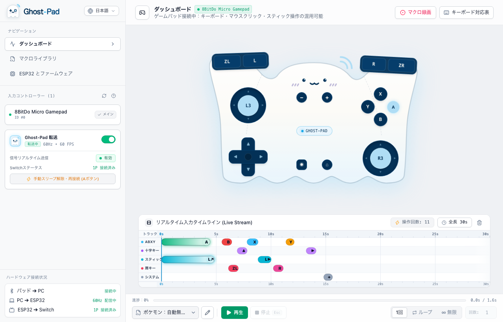
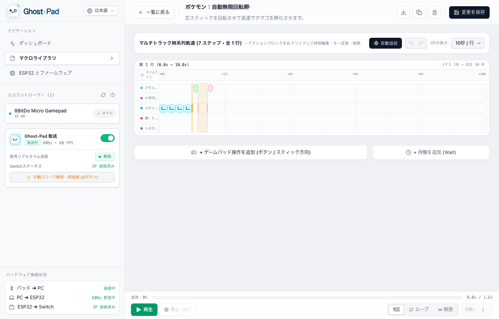

<div align="center">


# Ghost-Pad

**[English](README.md) | [繁體中文](README.zh-TW.md) | [日本語](README.ja.md)**

Nintendo Switch 向けの高性能 PC 仮想コントローラーブリッジ、リアルタイムビジュアライザー、およびマクロ自動化スタジオ。

[](https://tauri.app/)
[](https://react.dev/)
[](https://www.rust-lang.org/)
[](https://www.typescriptlang.org/)
[](desktop/README.md)

<br />



</div>

## 概要

**Ghost-Pad** は、PC を Nintendo Switch のインテリジェントなコントローラー中核として機能させるデスクトップアプリケーションです（Tauri v2 / Rust / React 19 製）。物理コントローラー、キーボード、画面操作、および自動マクロからの入力をリアルタイムに統合し、USB シリアル（`19200 bps`、UARTSwitchCon 9-Byte + CRC-8）経由で ESP32 開発ボードへ 60Hz で送信します。ESP32 は Bluetooth Classic により純正 **Nintendo Switch Pro コントローラー**（`VID: 0x057E`、`PID: 0x2009`）をエミュレートします。

```text
PC (Ghost-Pad Desktop)  ──[ USB シリアル 19200 bps ]──▶  ESP32 (Bluetooth Classic HID)  ──[ ワイヤレス ]──▶  Nintendo Switch
```

> [!NOTE]
> Nintendo Switch との接続には、**Bluetooth Classic (BR/EDR)** に対応した ESP32 開発ボードが必要です。ビルド済みファームウェア（`firmware/PRO-UART0.bin`）はアプリに同梱されており、ワンクリックで書き込みできます。

## スクリーンショット

<div align="center">

| マクロスタジオ & ループ再生エンジン | ESP32 ハードウェア設定 & Switch ペアリング |
| :---: | :---: |
|  |  |

</div>

## 主な機能

- **3系統並行入力ブリッジ (Tri-Input Bridge)**：
  - **物理コントローラー**：`gilrs` による低遅延ネイティブポーリング（< 1ms）で、8BitDo Micro、Switch Pro コントローラー、Joy-Con（Bluetooth / USB）に対応。
  - **キーボード直接操作**：デフォルトの WASD アナログスティック操作および Switch アクション／システムキー割り当て。
  - **タッチ / マウス操作**：ゴーストコントローラーの直接クリックと、120Hz ハードウェアアクセラレーション対応のアナログスティックドラッグ（Pointer Capture・物理スプリングリバウンド搭載）。
  - **スマート入力マージ**：デジタルボタンの論理和（OR）、スティック／十字キーの動的オーバーライド、誤入力を防ぐワンクリックミュート（Mute）モード。
- **リアルタイムビジュアライザー & フローティング HUD**：
  - 動的な表情フィードバックとデュアルスティック角度表示を備えたゴースト型 2D コントローラー。
  - 自動等比スケーリング（Auto Scale-to-Fit）に対応し、ウィンドウが `720×460` 未満になるとコンパクトなフローティング HUD へ自動切替。
- **リアルタイム入力タイムライン**：
  - 5 トラック構成の DAW / 逆太鼓スタイル譜面（アクション、十字キー、スティック、ショルダー、システム）。長押し光帯、速度プリセット（`10s` / `15s` / `30s` / `60s`）、アクションカウンターを表示。
- **マクロスタジオ & ループ再生エンジン**：
  - **リアルタイム差分レコーディング**：3-2-1 カウントダウン待機後、ミリ秒単位でホールド時間とスティックベクトルを記録。
  - **タイムライン & カードエディター**：各ステップの継続時間（`durationMs`）と待機時間（`delayAfterMs`）を微調整でき、ドラッグ＆ドロップによる並び替えや不要な待機時間のワンクリック削除に対応。
  - **ループ再生 & フェイルセーフ**：1 回再生、回数指定（`2–999`）、無限ループ（`∞`）に対応。`0.5x–2.0x` の速度調整と、グローバル `Esc` キーによる緊急停止を搭載。
  - **プリセット & バックアップ**：ポケモン孵化やあつ森の流れ星祈願などのプリセットを内蔵し、単一 JSON のインポート／エクスポートおよび全体バックアップに対応。
- **ハードウェア & ファームウェア管理**：
  - ESP32 シリアルポートおよびチップ（CH340 / CP2102 / FTDI）を自動検出し、仮想 Bluetooth ポートを除外。
  - 60Hz ハートビート送信と 200ms ウォッチドッグ保護により、切断時のボタン押しっぱなしを防止。
  - Switch ペアリングガイド、ペアリング記憶、A / Home ボタンによる復帰再接続、ワンクリックファームウェア書き込みを内蔵。
- **多言語 UI**：
  - 英語（`en`）、繁体字中国語（`zh-TW`）、日本語（`ja`）をリアルタイムに切り替え可能。

## クイックスタート

### ダウンロード（macOS）

ソースからビルドせずにすぐ利用できます：

1. **[GitHub Releases](https://github.com/shihchi/ghost-pad/releases)** ページを開きます。
2. 最新の **`Ghost-Pad_<version>_universal.dmg`**（Apple Silicon / Intel Mac 両対応の Universal バイナリ）をダウンロードします。
3. `.dmg` を開き、**Ghost-Pad** を「アプリケーション (Applications)」フォルダにドラッグします。

### ESP32 ファームウェアの書き込み

ESP32 を USB で PC に接続し、以下のいずれかの方法でファームウェアを書き込みます：

- **アプリ内から書き込み（推奨）**：Ghost-Pad の「ハードウェア設定」画面からワンクリックで `firmware/PRO-UART0.bin` を書き込みます。
- **手動書き込み（`esptool`）**：
  ```bash
  python -m esptool --port <YOUR_PORT> --baud 460800 write-flash 0x0 firmware/PRO-UART0.bin
  ```

### ソースコードからビルド

前提条件：**Node.js 18+**、**Rust ツールチェーン**、**Xcode Command Line Tools**（macOS）。

```bash
cd desktop
npm install
npm run tauri dev
```

> [!TIP]
> Tauri やハードウェア接続なしで React UI のみをブラウザでプレビュー・開発する場合は、`desktop/` ディレクトリで `npm run dev` を実行し、`http://localhost:1420/` を開いてください。

## ディレクトリ構造

```text
ghost-pad/
├── desktop/                      # Tauri v2 + React 19 + TypeScript + Rust デスクトップアプリ
│   ├── ARCHITECTURE.md           # システムアーキテクチャおよびコンポーネント設計書
│   ├── README.md                 # 環境構築、キー割り当て、ビルドおよびテストガイド
│   ├── src/                      # React フロントエンド（ビジュアライザー、タイムライン、マクロ、ハードウェア）
│   │   ├── components/           # UI コンポーネントおよび Canvas レンダラー
│   │   ├── hooks/                # 入力ブリッジ、スティック物理、マクロ記録・再生 Hooks
│   │   └── i18n/                 # 多言語リソース（en、zh-TW、ja）
│   └── src-tauri/                # Rust バックエンド（gilrs、60Hz シリアル送信、プロトコル）
├── firmware/                     # ビルド済み ESP32 ファームウェア
│   ├── PRO-UART0.bin             # Switch Pro コントローラー Bluetooth Classic イメージ（0x0 書き込み）
│   └── README.md                 # ファームウェア書き込みリファレンス
└── docs/                         # 仕様書および実装ドキュメント
    ├── technical_spec.ja.md      # 低レイヤシリアルプロトコル（CRC-8 / XOR）および ESP32 HID 仕様
    ├── desktop_app_plan.ja.md    # 機能仕様および検証チェックリスト
    └── assets/                   # ロゴおよび各言語スクリーンショット
```

## ドキュメント

| ドキュメント | 内容 |
| :--- | :--- |
| [デスクトップ開発ガイド](desktop/README.md) | 必要環境、開発モード、デフォルトキーボード割り当て、自動テスト（109件） |
| [アーキテクチャ設計書](desktop/ARCHITECTURE.md) | 3系統入力マージアルゴリズム、コンポーネント設計、UART 通信フロー |
| [技術・通信プロトコル仕様書](docs/technical_spec.ja.md) | 9-Byte CRC-8 / 10-Byte XOR パケット形式および ESP32 HID 実装詳細 |
| [システム実装仕様書](docs/desktop_app_plan.ja.md) | モジュール仕様、ロードマップ、検証チェックリスト |
| [ファームウェアガイド](firmware/README.md) | 同梱ファームウェア情報および `esptool` 手動書き込みコマンド |
