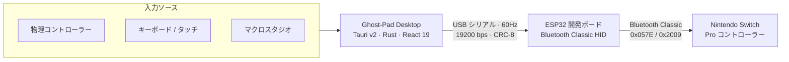

<div align="center">


# Ghost-Pad

**[English](README.md) | [繁體中文](README.zh-TW.md) | [日本語](README.ja.md)**

**[インタラクティブ操作ガイド →](https://huskyhsu.github.io/ghost-pad/?lang=ja)**

Nintendo Switch 向けの高性能 PC 仮想コントローラーブリッジ、リアルタイムビジュアライザー、およびマクロ自動化スタジオ。

[](https://tauri.app/)
[](https://react.dev/)
[](https://www.rust-lang.org/)
[](https://www.typescriptlang.org/)
[](desktop/README.md)
[](LICENSE)

<br />


</div>

## 概要

**Ghost-Pad** は、PC を Nintendo Switch のコントローラーハブとして機能させるデスクトップアプリです。物理コントローラー、キーボード、画面操作、自動マクロからの入力をリアルタイムに統合し、USB シリアル経由で ESP32 開発ボードへ 60Hz で送信。ESP32 が Bluetooth Classic で純正 **Nintendo Switch Pro コントローラー** をエミュレートします。



> [!NOTE]
> **Bluetooth Classic (BR/EDR)** 対応の ESP32 開発ボードが必要です。ビルド済みファームウェア（`firmware/PRO-UART0.bin`）はアプリに同梱されており、ワンクリックで書き込みできます。

## スクリーンショット

<div align="center">

| マクロスタジオ & ループ再生エンジン | ESP32 ハードウェア設定 & Switch ペアリング |
| :---: | :---: |
|  |  |

</div>

## 主な機能

- **3系統並行入力ブリッジ**：物理コントローラー（`gilrs` < 1ms ポーリング、8BitDo Micro / Pro コントローラー / Joy-Con 対応）、WASD キーボード操作、120Hz タッチ／マウス操作を統合。論理和（OR）マージ、スティック動的オーバーライド、ワンクリックミュートに対応。
- **リアルタイムビジュアライザー & フローティング HUD**：動的表情とデュアルスティック角度表示を備えたゴースト型 2D コントローラー。`720×460` 未満でコンパクトなフローティング HUD に自動切替。
- **リアルタイム入力タイムライン**：5 トラック構成（アクション、十字キー、スティック、ショルダー、システム）で長押し光帯、速度プリセット（`10s`–`60s`）、アクションカウンターを表示。
- **マクロスタジオ & ループエンジン**：3-2-1 カウントダウンのミリ秒単位レコーディング、5 トラック複数行ビジュアルエディター（右クリックでのミリ秒調整・ボタン変更・削除、手動でのアクションおよび空白待機 Wait の挿入、元に戻す／やり直しに対応）、ループ再生（1 回／`2–999`／無限、グローバル `Esc` 緊急停止）、内蔵プリセット、JSON インポート／エクスポートに対応。
- **ハードウェア & ファームウェア管理**：ESP32 シリアルポート自動検出（CH340 / CP2102 / FTDI）、60Hz ハートビート＋200ms 切断保護ウォッチドッグ、Switch ペアリングガイド、ワンクリックファームウェア書き込みを内蔵。
- **多言語 UI**：英語（`en`）、繁体字中国語（`zh-TW`）、日本語（`ja`）をリアルタイム切替。

## クイックスタート

### ダウンロード（macOS）

ソースからビルドせずにすぐ利用できます：

1. **[GitHub Releases](https://github.com/HuskyHsu/ghost-pad/releases)** ページを開きます。
2. 最新の **`Ghost-Pad_<version>_universal.dmg`**（Apple Silicon / Intel Mac 両対応の Universal バイナリ）をダウンロードします。
3. `.dmg` を開き、**Ghost-Pad** を「アプリケーション (Applications)」フォルダにドラッグします。

### ESP32 ファームウェアの書き込み

ESP32 を USB で PC に接続し、以下のいずれかの方法でファームウェアを書き込みます：

- **アプリ内から書き込み（推奨）**：Ghost-Pad の「ハードウェア設定」画面からワンクリックで `firmware/PRO-UART0.bin` を書き込みます。
- **手動書き込み（`esptool`）**：
  ```bash
  python -m esptool --port <YOUR_PORT> --baud 460800 write-flash 0x0 firmware/PRO-UART0.bin
  ```

### ソースコードからビルド

前提条件：**Node.js 18+**、**Rust ツールチェーン**、**Xcode Command Line Tools**（macOS）。

```bash
cd desktop
npm install
npm run tauri dev
```

> [!TIP]
> Tauri やハードウェア接続なしで React UI のみをブラウザでプレビュー・開発する場合は、`desktop/` ディレクトリで `npm run dev` を実行し、`http://localhost:1420/` を開いてください。

## ディレクトリ構造

```text
ghost-pad/
├── desktop/                      # Tauri v2 + React 19 + TypeScript + Rust デスクトップアプリ
│   ├── ARCHITECTURE.md           # システムアーキテクチャおよびコンポーネント設計書
│   ├── README.md                 # 環境構築、キー割り当て、ビルドおよびテストガイド
│   ├── src/                      # React フロントエンド（ビジュアライザー、タイムライン、マクロ、ハードウェア）
│   │   ├── components/           # UI コンポーネントおよび Canvas レンダラー
│   │   ├── hooks/                # 入力ブリッジ、スティック物理、マクロ記録・再生 Hooks
│   │   └── i18n/                 # 多言語リソース（en、zh-TW、ja）
│   └── src-tauri/                # Rust バックエンド（gilrs、60Hz シリアル送信、プロトコル）
├── firmware/                     # ビルド済み ESP32 ファームウェア
│   ├── PRO-UART0.bin             # Switch Pro コントローラー Bluetooth Classic イメージ（0x0 書き込み）
│   └── README.md                 # ファームウェア書き込みリファレンス
└── docs/                         # 仕様書および実装ドキュメント
    ├── technical_spec.ja.md      # 低レイヤシリアルプロトコル（CRC-8 / XOR）および ESP32 HID 仕様
    ├── desktop_app_plan.ja.md    # 機能仕様および検証チェックリスト
    └── assets/                   # ロゴおよび各言語スクリーンショット
```

## ドキュメント

| ドキュメント | 内容 |
| :--- | :--- |
| [デスクトップ開発ガイド](desktop/README.md) | 必要環境、開発モード、デフォルトキーボード割り当て、自動テスト（109件） |
| [アーキテクチャ設計書](desktop/ARCHITECTURE.md) | 3系統入力マージアルゴリズム、コンポーネント設計、UART 通信フロー |
| [技術・通信プロトコル仕様書](docs/technical_spec.ja.md) | 9-Byte CRC-8 / 10-Byte XOR パケット形式および ESP32 HID 実装詳細 |
| [システム実装仕様書](docs/desktop_app_plan.ja.md) | モジュール仕様、ロードマップ、検証チェックリスト |
| [ファームウェアガイド](firmware/README.md) | 同梱ファームウェア情報および `esptool` 手動書き込みコマンド |

## ライセンス

本プロジェクトは **[GNU General Public License v3.0 (GPL-3.0)](LICENSE)** の下で公開されています。

### サードパーティファームウェアおよび商標について

- **同梱 ESP32 ファームウェア（`firmware/PRO-UART0.bin`）**：**[UARTSwitchCon](https://github.com/nullstalgia/UARTSwitchCon)**（[pynscontroller](https://github.com/shinyypig/pynscontroller) にも収録）に由来し、同じく **GPL-3.0** ライセンスの下で公開されています。
- **免責事項**：*Nintendo Switch* および *Pro Controller* は任天堂株式会社の登録商標です。Ghost-Pad は独立したオープンソースプロジェクトであり、任天堂株式会社とは一切関係なく、公式に承認されたものではありません。

