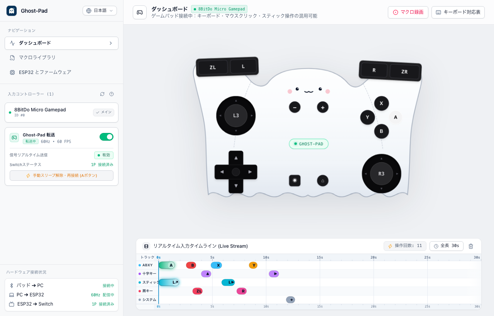
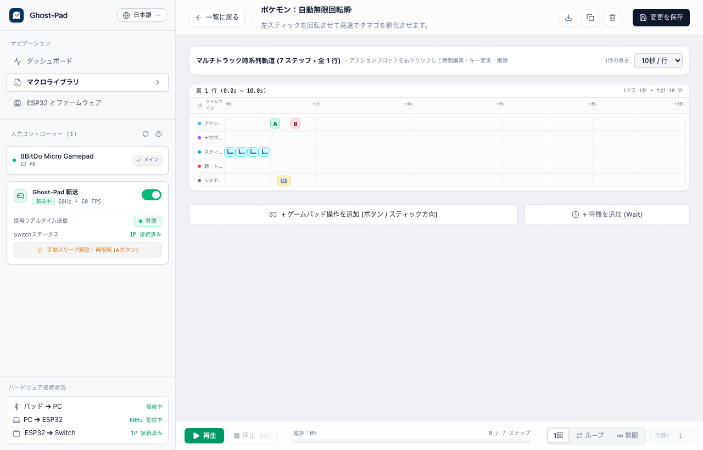

# 👻 Ghost-Pad (PC-to-Switch Controller Bridge)

<div align="center">

**[English](README.md) | [繁體中文](README.zh-TW.md) | [日本語](README.ja.md)**

Nintendo Switch 向け高性能 PC 仮想コントローラープロキシ・リアルタイム可視化ダッシュボード・マクロ自動化システム。

[](https://opensource.org/licenses/MIT)
[](https://tauri.app/)
[](https://react.dev/)
[](https://www.rust-lang.org/)
[](https://www.typescriptlang.org/)
[](desktop)

</div>

---

Ghost-Pad は、Nintendo Switch 向けに開発された高性能仮想コントローラーブリッジ、リアルタイムビジュアライザー、およびマクロ自動化スタジオです。  
PC をスマートコントローラーの中核とし、USB シリアル通信を通じて ESP32 開発ボードにコマンドを送信し、Bluetooth Classic 経由で純正 **Nintendo Switch Pro コントローラー**（VID: `0x057E`、PID: `0x2009`）を正確にエミュレートします。

<div align="center">
  
</div>

---

## 📸 スクリーンショット (Screenshots)

<div align="center">

| ゴーストビジュアライザー & 五線譜タイムライン | マクロスタジオ & ループ再生エンジン |
| :---: | :---: |
|  |  |

| ESP32 シリアル接続 & Switch 3ステップペアリング設定 |
| :---: |
|  |

</div>

---

## 🌟 主な特徴

- 🎮 **3系統並行入力ブリッジ (Tri-Input Bridge)**：
  - **物理コントローラー**：8BitDo Micro、Switch Pro コントローラー、Joy-Con を Bluetooth または USB で低遅延ポーリング（`gilrs`、遅延 < 1ms）。
  - **PC キーボード**：デフォルトの WASD とキー割り当てで、斜めスティック入力や各アクションキーに対応。
  - **画面タッチ / マウス**：ゴーストコントローラーのボタンを直接クリックしたり、アナログスティックを滑らかにドラッグ（120Hz ハードウェアアクセラレーション DOM Transform、Pointer Capture、物理スプリングリバウンド対応）。
  - **スマート入力マージ**：デジタルボタンの論理和（OR）、方向キーとスティックの動的オーバーライド、誤操作防止用ワンクリックミュート（Mute）モード。
- 👻 **ゴーストコントローラー・リアルタイムビジュアライザー & HUD モード**：
  - 愛らしいゴーストデザインのコントローラー。メタモンのような動的表情フィードバックとデュアルスティックの角度可視化。
  - レスポンシブ自動等比スケーリング（Auto Scale-to-Fit）。ウィンドウを 720x460 未満に縮小すると、自動的に極小フローティング HUD モードに切り替わります。
- 🎼 **リアルタイムタイムラインストリーム (Live Timeline Stream)**：
  - DAW / 逆太鼓スタイルの 5 トラック構成（アクション、十字キー、スティック、ショルダー、システム）。
  - 長押し光帯のリアルタイム伸縮、速度プリセット（10s / 15s / 30s / 60s）、動的アクションカウンター表示。
- 🎬 **マクロスタジオ & ループ再生エンジン (Macro Studio & Playback)**：
  - **リアルタイム差分レコーディング**：3-2-1 カウントダウン待機後、ミリ秒単位でボタンのホールド時間とスティックベクトルを正確に記録。
  - **タイムライン & カードエディター**：各アクションの継続時間 (`durationMs`) と待機時間 (`delayAfterMs`) を視覚的に微調整。ドラッグ＆ドロップによる順序変更、不要な待機時間のワンクリックトリミング。
  - **全自動ループ再生**：1 回再生、指定 N 回ループ（2〜999 回）、無限ループ（∞）。0.5x〜2.0x の速度調整、`Esc` キーによる緊急停止・誤入力防止フェイルセーフ。
  - **プリセットライブラリ & バックアップ**：ポケモンの無限孵化・回転、あつ森の流れ星祈願など実用プリセット内蔵。単一 JSON のエクスポート/インポートおよびライブラリ全体のバックアップに対応。
- ⚡ **厳格なシーケンシャルハードウェア管理 (Hardware Management)**：
  - ESP32 シリアルポートおよびチップ（CH340 / CP2102 / FTDI など）の自動認識、仮想 Bluetooth ポートの自動除外。
  - 60Hz ハートビート送信スレッドと安全監視ウォッチドッグ（200ms タイムアウト保護）。
  - Switch ペアリングガイド、ペアリング情報の記憶、A / Home ボタンによる迅速なスリープ復帰と再接続。
  - ワンクリックファームウェア書き込みツール内蔵（`firmware/PRO-UART0.bin` 同梱、追加のコンパイル環境不要）。
- 🌐 **ネイティブ多言語対応 (i18n)**：
  - 繁体字中国語（`zh-TW`）、英語（`en`）、日本語（`ja`）に対応し、リアルタイムに切り替え可能。

---

## 📁 ディレクトリ構造

```
ghost-pad/
├── desktop/                  # 🖥️ メインデスクトップアプリ (Tauri v2 + React 19 + TypeScript + Rust)
│   ├── ARCHITECTURE.md       # 技術アーキテクチャおよびコンポーネント設計書
│   ├── README.md             # デスクトップアプリの使用・ビルドガイド
│   ├── src/                  # React フロントエンド (ビジュアライザー、タイムライン、マクロ、ハードウェア)
│   │   ├── components/       # UI コンポーネント群
│   │   ├── hooks/            # useVirtualGamepad, useStickDrag, useMacroRecorder, useMacroPlayer
│   │   └── i18n/             # 多言語定義 (zh-TW, en, ja)
│   └── src-tauri/            # Rust バックエンド (gilrs、serial 60Hz ハートビート、プロトコル)
├── firmware/                 # 🔌 ESP32 ファームウェアリソース
│   └── PRO-UART0.bin         # Switch Pro コントローラー Bluetooth Classic 結合済みファームウェア (0x0 開始)
└── docs/                     # 📚 仕様書・実装ドキュメント
    ├── technical_spec.md     # 低レイヤバイナリプロトコル (CRC8 / XOR) および ESP32 仕様書 (デフォルト英語)
    ├── technical_spec.zh-TW.md # 通信プロトコル仕様書 (繁体字中国語)
    ├── technical_spec.ja.md  # 通信プロトコル仕様書 (日本語)
    ├── desktop_app_plan.md   # デスクトップシステム実装仕様および機能検証チェックリスト (デフォルト英語)
    ├── desktop_app_plan.zh-TW.md # システム実装仕様書 (繁体字中国語)
    └── desktop_app_plan.ja.md # システム実装仕様書 (日本語)
```

---

## 📦 ダウンロードとインストール (Download & Releases)

一般的なユーザーは、開発環境の構築やソースコードのコンパイルを行う必要はありません：
- 本プロジェクトの **[GitHub Releases ページ](https://github.com/shihchi/ghost-pad/releases)** にアクセスします。
- 最新の **`Ghost-Pad_<version>_universal.dmg`**（Apple Silicon M1/M2/M3/M4 と Intel Mac の両方に対応した Universal バイナリ）をダウンロードします。
- `.dmg` ファイルを開き、**Ghost-Pad** を「アプリケーション (Applications)」フォルダにドラッグするだけで、すぐにご利用いただけます！

---

## 🛠️ 開発とコントリビューション (Contributing)

ソースコードからのビルドや開発への参加については、以下の詳細ガイドをご覧ください：
- 📖 [デスクトップ開発・環境構築ガイド (desktop/README.md)](desktop/README.md)：必要環境、開発モード（Tauri / ブラウザ）、キーボード対照表、自動テスト（109件すべて合格）。
- 📐 [アーキテクチャ・プロトコル設計書 (desktop/ARCHITECTURE.md)](desktop/ARCHITECTURE.md)：3系統入力マージアルゴリズム、通信仕様書。
- 🔌 [通信プロトコル・ハードウェア仕様書 (docs/technical_spec.md)](docs/technical_spec.md)：バイナリパケット仕様、CRC8/XOR アルゴリズム、Bluetooth HID エミュレーション。
- 📝 [システム実装仕様書 (docs/desktop_app_plan.md)](docs/desktop_app_plan.md)：機能ロードマップ、モジュール仕様、検証チェックリスト。

---

## 📄 ライセンス (License)

本プロジェクトは [MIT License](LICENSE) のもとでオープンソースとして公開されています。

