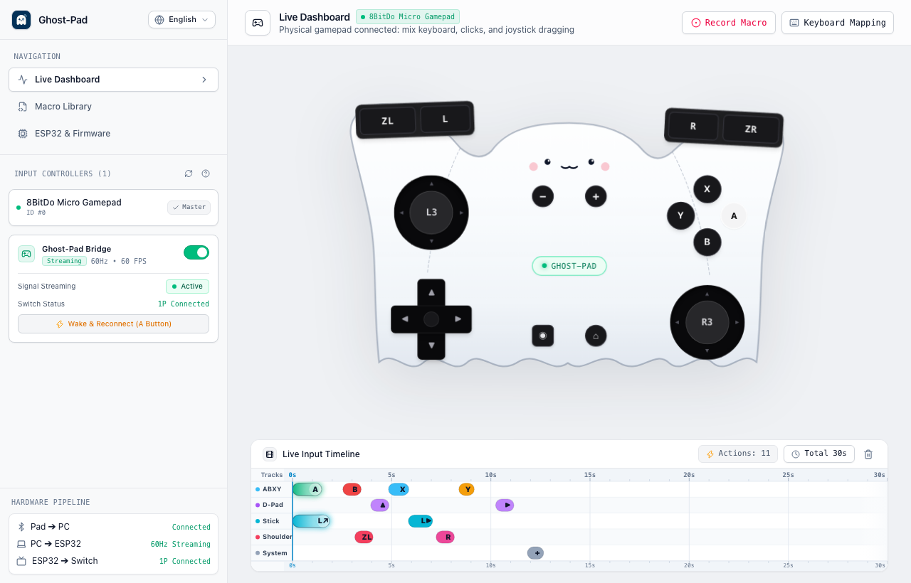
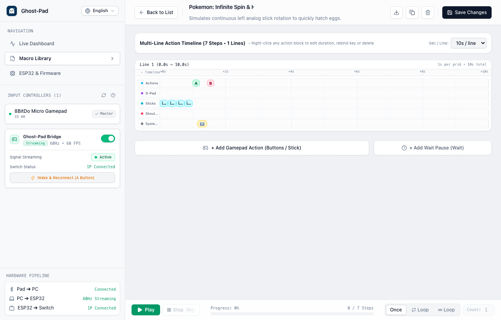
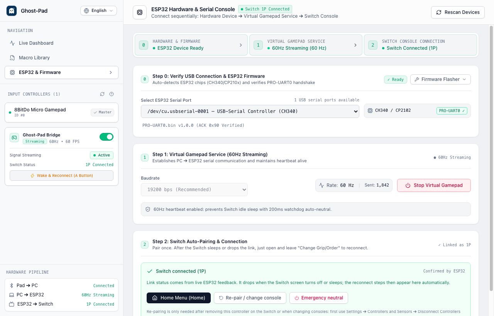

# 👻 Ghost-Pad (PC-to-Switch Controller Bridge)

<div align="center">

**[English](README.md) | [繁體中文](README.zh-TW.md) | [日本語](README.ja.md)**

High-performance PC-to-Nintendo Switch virtual controller bridge, live visualizer dashboard, and macro automation system.

[](https://opensource.org/licenses/MIT)
[](https://tauri.app/)
[](https://react.dev/)
[](https://www.rust-lang.org/)
[](https://www.typescriptlang.org/)
[](desktop)

</div>

---

Ghost-Pad is a high-performance virtual controller bridge, live visualizer dashboard, and macro automation studio built for the Nintendo Switch.  
Using your computer as an intelligent controller core, it sends commands via USB Serial to an ESP32 development board, which emulates an authentic **Nintendo Switch Pro Controller** over Bluetooth Classic (VID: `0x057E`, PID: `0x2009`).

<div align="center">
  
</div>

---

## 📸 Screenshots

<div align="center">

| Ghost Visualizer & Live Timeline | Macro Studio & Loop Engine |
| :---: | :---: |
|  |  |

| ESP32 Hardware & Switch Pairing Setup |
| :---: |
|  |

</div>

---

## 🌟 Key Features

- 🎮 **Tri-Input Bridge**:
  - **Physical Gamepad**: Native low-latency polling for 8BitDo Micro, Switch Pro Controller, and Joy-Con via Bluetooth or USB (`gilrs`, latency < 1ms).
  - **Keyboard Direct Control**: Default WASD and keyboard mappings, supporting diagonal analog vector simulation and action keys.
  - **Screen Touch / Mouse**: Direct clicks on the ghost controller buttons or fluid analog stick dragging (120Hz hardware-accelerated DOM Transform, Pointer Capture, and spring physics).
  - **Smart Input Merging**: Digital button union (OR logic), analog stick and D-Pad dynamic overrides, and one-click Mute mode to prevent accidental inputs.
- 👻 **Ghost Controller Live Visualizer & HUD Mode**:
  - Adorable ghost-themed 2D controller with dynamic Ditto expression feedback and dual-stick angle visualization.
  - Responsive Auto Scale-to-Fit; automatically transforms into a compact floating HUD widget when resized below 720x460.
- 🎼 **Live Input Timeline Stream**:
  - 5-track DAW / reverse Taiko style music score (Actions, D-Pad, Sticks, Shoulders, System keys).
  - Real-time optical beam trail stretching for long presses, speed presets (10s / 15s / 30s / 60s), and dynamic action counters.
- 🎬 **Macro Studio & Playback Engine**:
  - **Real-time Delta Recording**: 3-2-1 countdown buffer, capturing button press durations and stick movement vectors with millisecond precision.
  - **Visual Timeline & Card Editor**: Fine-tune each action's hold duration (`durationMs`) and delay (`delayAfterMs`), drag & drop step reordering, and one-click idle time trimming.
  - **Automated Loop Playback**: Single run, loop N times (2–999), or infinite loop (∞). Adjustable speeds (0.5x–2.0x), and global `Esc` key fail-safe abort.
  - **Preset Library & Backup**: Built-in scripts for Pokémon infinite spin / egg hatching, Animal Crossing meteor star wishing, etc. Supports single `.json` import/export and full library backup.
- ⚡ **Strict Sequential Hardware Management**:
  - Automatic ESP32 serial port enumeration and chip detection (CH340 / CP2102 / FTDI), filtering virtual Bluetooth ports.
  - 60Hz heartbeat packet transmission with safety watchdog (Watchdog Fail-Safe with 200ms timeout protection).
  - Switch pairing guides, persistent bond memory, and instant A / Home button wake-up reconnection.
  - Built-in one-click firmware flasher (pre-bundled with `firmware/PRO-UART0.bin`, no extra toolchain setup required).
- 🌐 **Native Multi-Language Support (i18n)**:
  - Built-in support for English (`en`), Traditional Chinese (`zh-TW`), and Japanese (`ja`), switchable on the fly.

---

## 📁 Repository Structure

```
ghost-pad/
├── desktop/                  # 🖥️ Main Desktop App (Tauri v2 + React 19 + TypeScript + Rust)
│   ├── ARCHITECTURE.md       # Technical architecture and component design manual
│   ├── README.md             # Desktop setup, keybindings, and compilation guide
│   ├── src/                  # React UI frontend (Visualizer, Timeline, Macro Studio, Hardware)
│   │   ├── components/       # Visualizer, Canvas timeline, Hardware settings, Macro Studio
│   │   ├── hooks/            # useVirtualGamepad, useStickDrag, useMacroRecorder, useMacroPlayer
│   │   └── i18n/             # Internationalization files (zh-TW, en, ja)
│   └── src-tauri/            # Rust backend (gilrs gamepad polling, serial 60Hz loop, packet protocol)
├── firmware/                 # 🔌 ESP32 Firmware Resources
│   └── PRO-UART0.bin         # Pre-compiled Switch Pro Controller Bluetooth Classic firmware (flash at 0x0)
└── docs/                     # 📚 Specifications and Implementation Guides
    ├── technical_spec.md     # Low-level binary protocol (CRC8 / XOR) and ESP32 Bluetooth specs (Default English)
    ├── technical_spec.zh-TW.md # Technical protocol specification (Traditional Chinese)
    ├── technical_spec.ja.md  # Technical protocol specification (Japanese)
    ├── desktop_app_plan.md   # Desktop implementation specification and acceptance checklist (Default English)
    ├── desktop_app_plan.zh-TW.md # Desktop implementation specification (Traditional Chinese)
    └── desktop_app_plan.ja.md # Desktop implementation specification (Japanese)
```

---

## 📦 Download & Releases

End users do not need to install developer toolchains or build from source:
- Visit the project's **[GitHub Releases Page](https://github.com/shihchi/ghost-pad/releases)**.
- Download the latest **`Ghost-Pad_<version>_universal.dmg`** (Universal binary supporting both Apple Silicon M1/M2/M3/M4 and Intel Macs).
- Open the `.dmg` file and drag **Ghost-Pad** into your Applications folder to run immediately!

---

## 🛠️ Contributing & Development

Interested in building Ghost-Pad from source or contributing to development?
- 📖 [Desktop Developer Guide & Setup](desktop/README.md) - Node/Rust prerequisites, development modes, keyboard shortcuts, and automated tests (109 passing).
- 📐 [Architecture & Protocol Specification](desktop/ARCHITECTURE.md) - System architecture, tri-input state merging, and ESP32 UART protocols.
- 🔌 [Technical Protocol Specification](docs/technical_spec.md) - Low-level packet formats, CRC8 / XOR algorithms, and Bluetooth HID emulation.
- 📝 [Implementation & Feature Checklist](docs/desktop_app_plan.md) - Development roadmap, module specifications, and verification benchmarks.

---

## 📄 License

This project is open-sourced under the [MIT License](LICENSE).
