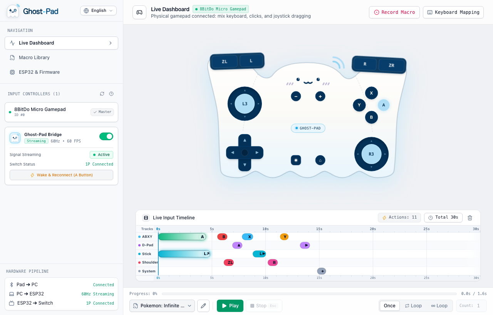
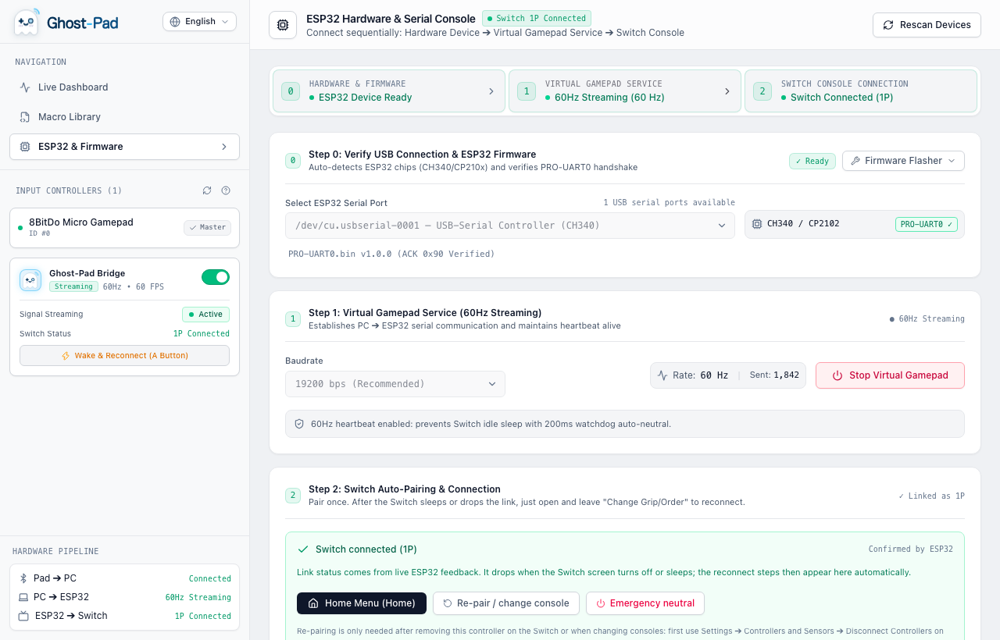

<div align="center">


# Ghost-Pad

**[English](README.md) | [繁體中文](README.zh-TW.md) | [日本語](README.ja.md)**

High-performance PC-to-Nintendo Switch virtual controller bridge, live visualizer dashboard, and macro automation studio.

[](https://tauri.app/)
[](https://react.dev/)
[](https://www.rust-lang.org/)
[](https://www.typescriptlang.org/)
[](desktop/README.md)

<br />



</div>

## Overview

**Ghost-Pad** turns your computer into an intelligent controller core for the Nintendo Switch. The desktop application (built with Tauri v2, Rust, and React 19) merges inputs from physical gamepads, keyboards, pointer controls, and automated macros, then streams 60Hz binary control packets over USB Serial (`19200 bps`, UARTSwitchCon 9-Byte + CRC-8) to an ESP32 development board. The ESP32 emulates a native **Nintendo Switch Pro Controller** over Bluetooth Classic (`VID: 0x057E`, `PID: 0x2009`).

```text
PC (Ghost-Pad Desktop)  ──[ USB Serial 19200 bps ]──▶  ESP32 (Bluetooth Classic HID)  ──[ Wireless ]──▶  Nintendo Switch
```

> [!NOTE]
> An ESP32 development board with **Bluetooth Classic (BR/EDR)** support is required to bridge commands to the Nintendo Switch. Pre-compiled firmware (`firmware/PRO-UART0.bin`) is bundled directly in the app with a built-in one-click flasher.

## Screenshots

<div align="center">

| Macro Studio & Loop Engine | ESP32 Hardware & Switch Pairing |
| :---: | :---: |
|  |  |

</div>

## Features

- **Tri-Input Bridge**:
  - **Physical Gamepad**: Low-latency native polling via `gilrs` (< 1ms) for 8BitDo Micro, Switch Pro Controller, and Joy-Con over Bluetooth or USB.
  - **Keyboard Direct Control**: Default WASD analog stick simulation and Switch action/system keybindings.
  - **Touch & Mouse Control**: Interactive ghost controller buttons and 120Hz hardware-accelerated analog stick dragging with pointer capture and spring return physics.
  - **Smart Input Merging**: Digital button OR-merging, dynamic stick/D-Pad override, and one-click Mute mode to prevent accidental inputs.
- **Live Visualizer & Floating HUD**:
  - Ghost-themed 2D controller with dynamic facial expressions and dual-stick angle feedback.
  - Responsive auto scale-to-fit layout that switches to a compact floating HUD when resized below `720×460`.
- **Live Input Timeline**:
  - 5-track DAW / reverse-Taiko score sheet (Actions, D-Pad, Sticks, Shoulders, System) with real-time hold trails, speed presets (`10s` / `15s` / `30s` / `60s`), and action counters.
- **Macro Studio & Loop Engine**:
  - **Real-Time Delta Recording**: 3-2-1 countdown buffer capturing button holds and stick vectors at millisecond precision.
  - **Visual Timeline & Card Editor**: Edit hold duration (`durationMs`) and delay (`delayAfterMs`), reorder steps by drag-and-drop, and trim idle gaps in one click.
  - **Loop Playback & Fail-Safe**: Single run, N-repeat (`2–999`), or infinite loop (`∞`) at `0.5x–2.0x` speed, with a global `Esc` emergency abort.
  - **Presets & Backup**: Built-in automation scripts (e.g., Pokémon egg hatching, Animal Crossing star wishing) with single-macro JSON import/export and full-library backup.
- **Hardware & Firmware Management**:
  - Automatic ESP32 serial port detection (CH340 / CP2102 / FTDI) with virtual Bluetooth port filtering.
  - 60Hz heartbeat packet loop with a 200ms watchdog fail-safe to prevent stuck inputs on disconnect.
  - Guided Switch pairing, persistent bond memory, quick A / Home wake-up reconnection, and built-in firmware flashing.
- **Multi-Language UI**:
  - Native English (`en`), Traditional Chinese (`zh-TW`), and Japanese (`ja`) interface with instant switching.

## Getting Started

### Download (macOS)

For end users who do not need to build from source:

1. Open the **[GitHub Releases](https://github.com/shihchi/ghost-pad/releases)** page.
2. Download the latest **`Ghost-Pad_<version>_universal.dmg`** (supports both Apple Silicon and Intel Macs).
3. Open the `.dmg` archive and drag **Ghost-Pad** into your **Applications** folder.

### ESP32 Firmware Setup

Connect your ESP32 via USB and flash the bundled firmware in one of two ways:

- **In-App (Recommended)**: Open **Hardware Settings** in Ghost-Pad and click **Flash Firmware** to write `firmware/PRO-UART0.bin` automatically.
- **Manual (`esptool`)**:
  ```bash
  python -m esptool --port <YOUR_PORT> --baud 460800 write-flash 0x0 firmware/PRO-UART0.bin
  ```

### Build from Source

Prerequisites: **Node.js 18+**, **Rust toolchain**, and **Xcode Command Line Tools** (on macOS).

```bash
cd desktop
npm install
npm run tauri dev
```

> [!TIP]
> To preview or develop the React UI in a browser without Tauri or hardware bindings, run `npm run dev` inside `desktop/` and open `http://localhost:1420/`.

## Repository Structure

```text
ghost-pad/
├── desktop/                      # Tauri v2 + React 19 + TypeScript + Rust desktop app
│   ├── ARCHITECTURE.md           # System architecture and component design
│   ├── README.md                 # Setup, keyboard mappings, build, and test guide
│   ├── src/                      # React frontend (Visualizer, Timeline, Macro Studio, Hardware)
│   │   ├── components/           # UI components and canvas renderers
│   │   ├── hooks/                # Input bridge, stick physics, macro recorder & player
│   │   └── i18n/                 # Translations (en, zh-TW, ja)
│   └── src-tauri/                # Rust backend (gilrs polling, 60Hz serial loop, protocol)
├── firmware/                     # Pre-compiled ESP32 firmware
│   ├── PRO-UART0.bin             # Switch Pro Controller Bluetooth Classic image (flash at 0x0)
│   └── README.md                 # Firmware flashing reference
└── docs/                         # Protocol and implementation specifications
    ├── technical_spec.md         # Binary serial protocol (CRC-8 / XOR) & Bluetooth HID spec
    ├── desktop_app_plan.md       # Feature specifications and acceptance checklist
    └── assets/                   # Logo and localized screenshots
```

## Documentation

| Document | Description |
| :--- | :--- |
| [Desktop Developer Guide](desktop/README.md) | Prerequisites, dev modes, default keyboard mappings, and test suite (109 tests) |
| [Architecture Reference](desktop/ARCHITECTURE.md) | Tri-input state merging, component design, and UART protocol flow |
| [Technical Specification](docs/technical_spec.md) | Low-level 9-byte CRC-8 / 10-byte XOR packet formats and ESP32 HID details |
| [Implementation Plan](docs/desktop_app_plan.md) | Module specifications, roadmap, and verification checklist |
| [Firmware Guide](firmware/README.md) | Pre-compiled firmware details and manual `esptool` flashing commands |
