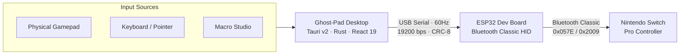
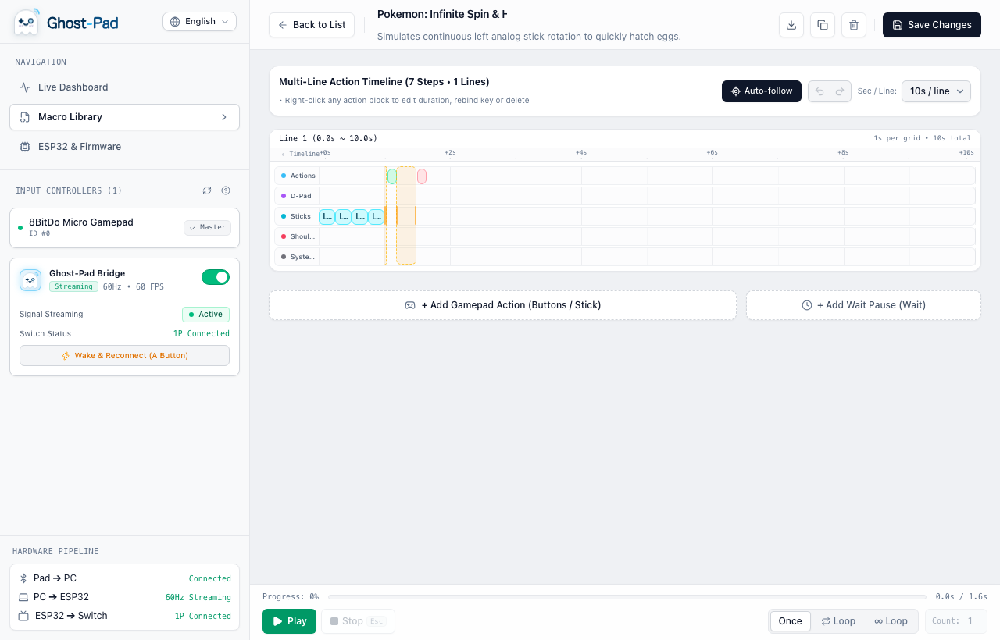

<div align="center">


# Ghost-Pad

**[English](README.md) | [繁體中文](README.zh-TW.md) | [日本語](README.ja.md)**

**[Interactive Guide & Visual Manual →](https://huskyhsu.github.io/ghost-pad/)**

High-performance PC-to-Nintendo Switch virtual controller bridge, live visualizer dashboard, and macro automation studio.

[](https://tauri.app/)
[](https://react.dev/)
[](https://www.rust-lang.org/)
[](https://www.typescriptlang.org/)
[](desktop/README.md)

<br />


</div>

## Overview

**Ghost-Pad** turns your computer into a Nintendo Switch controller hub. It merges inputs from physical gamepads, keyboards, pointer controls, and automated macros, then streams 60Hz control packets over USB Serial to an ESP32 board that emulates a native **Nintendo Switch Pro Controller** over Bluetooth Classic.



> [!NOTE]
> Requires an ESP32 board with **Bluetooth Classic (BR/EDR)** support. Pre-compiled firmware (`firmware/PRO-UART0.bin`) is bundled in the app with a one-click flasher.

## Screenshots

<div align="center">

| Macro Studio & Loop Engine | ESP32 Hardware & Switch Pairing |
| :---: | :---: |
|  |  |

</div>

## Features

- **Tri-Input Bridge**: Merges physical gamepads (`gilrs` < 1ms polling for 8BitDo Micro, Pro Controller, Joy-Con), WASD keyboard controls, and 120Hz touch/mouse inputs with OR-merging, dynamic stick override, and one-click Mute.
- **Live Visualizer & Floating HUD**: Interactive ghost-themed 2D controller with dynamic expressions and stick angle feedback; auto-scales to a compact floating HUD below `720×460`.
- **Live Input Timeline**: 5-track DAW-style timeline (Actions, D-Pad, Sticks, Shoulders, System) with hold trails, speed presets (`10s`–`60s`), and action counters.
- **Macro Studio & Loop Engine**: Millisecond-precision delta recording (3-2-1 countdown), 5-track multi-row visual editor (right-click to edit ms duration, swap buttons, or delete; insert gamepad actions or blank Wait blocks; undo/redo), loop playback (`1` / `2–999` / `∞` with global `Esc` abort), built-in presets, and JSON import/export.
- **Hardware & Firmware**: Auto-detects ESP32 USB serial ports (CH340 / CP2102 / FTDI), maintains a 60Hz heartbeat with a 200ms disconnect watchdog, and includes guided Switch pairing and one-click firmware flashing.
- **Multi-Language UI**: Instant switching between English (`en`), Traditional Chinese (`zh-TW`), and Japanese (`ja`).

## Getting Started

### Download (macOS)

For end users who do not need to build from source:

1. Open the **[GitHub Releases](https://github.com/HuskyHsu/ghost-pad/releases)** page.
2. Download the latest **`Ghost-Pad_<version>_universal.dmg`** (supports both Apple Silicon and Intel Macs).
3. Open the `.dmg` archive and drag **Ghost-Pad** into your **Applications** folder.

### ESP32 Firmware Setup

Connect your ESP32 via USB and flash the bundled firmware in one of two ways:

- **In-App (Recommended)**: Open **Hardware Settings** in Ghost-Pad and click **Flash Firmware** to write `firmware/PRO-UART0.bin` automatically.
- **Manual (`esptool`)**:
  ```bash
  python -m esptool --port <YOUR_PORT> --baud 460800 write-flash 0x0 firmware/PRO-UART0.bin
  ```

### Build from Source

Prerequisites: **Node.js 18+**, **Rust toolchain**, and **Xcode Command Line Tools** (on macOS).

```bash
cd desktop
npm install
npm run tauri dev
```

> [!TIP]
> To preview or develop the React UI in a browser without Tauri or hardware bindings, run `npm run dev` inside `desktop/` and open `http://localhost:1420/`.

## Repository Structure

```text
ghost-pad/
├── desktop/                      # Tauri v2 + React 19 + TypeScript + Rust desktop app
│   ├── ARCHITECTURE.md           # System architecture and component design
│   ├── README.md                 # Setup, keyboard mappings, build, and test guide
│   ├── src/                      # React frontend (Visualizer, Timeline, Macro Studio, Hardware)
│   │   ├── components/           # UI components and canvas renderers
│   │   ├── hooks/                # Input bridge, stick physics, macro recorder & player
│   │   └── i18n/                 # Translations (en, zh-TW, ja)
│   └── src-tauri/                # Rust backend (gilrs polling, 60Hz serial loop, protocol)
├── firmware/                     # Pre-compiled ESP32 firmware
│   ├── PRO-UART0.bin             # Switch Pro Controller Bluetooth Classic image (flash at 0x0)
│   └── README.md                 # Firmware flashing reference
└── docs/                         # Protocol and implementation specifications
    ├── technical_spec.md         # Binary serial protocol (CRC-8 / XOR) & Bluetooth HID spec
    ├── desktop_app_plan.md       # Feature specifications and acceptance checklist
    └── assets/                   # Logo and localized screenshots
```

## Documentation

| Document | Description |
| :--- | :--- |
| [Desktop Developer Guide](desktop/README.md) | Prerequisites, dev modes, default keyboard mappings, and test suite (109 tests) |
| [Architecture Reference](desktop/ARCHITECTURE.md) | Tri-input state merging, component design, and UART protocol flow |
| [Technical Specification](docs/technical_spec.md) | Low-level 9-byte CRC-8 / 10-byte XOR packet formats and ESP32 HID details |
| [Implementation Plan](docs/desktop_app_plan.md) | Module specifications, roadmap, and verification checklist |
| [Firmware Guide](firmware/README.md) | Pre-compiled firmware details and manual `esptool` flashing commands |
