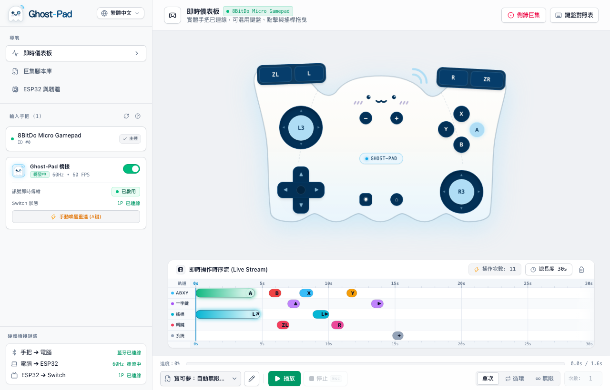
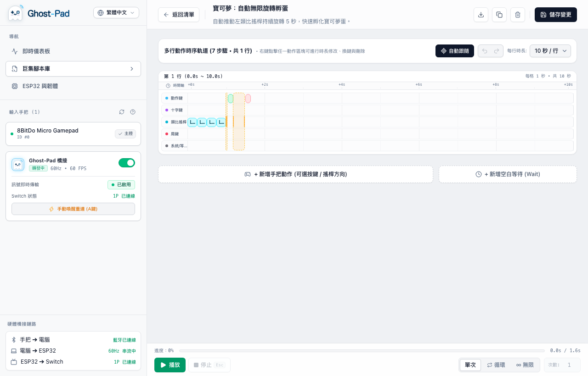
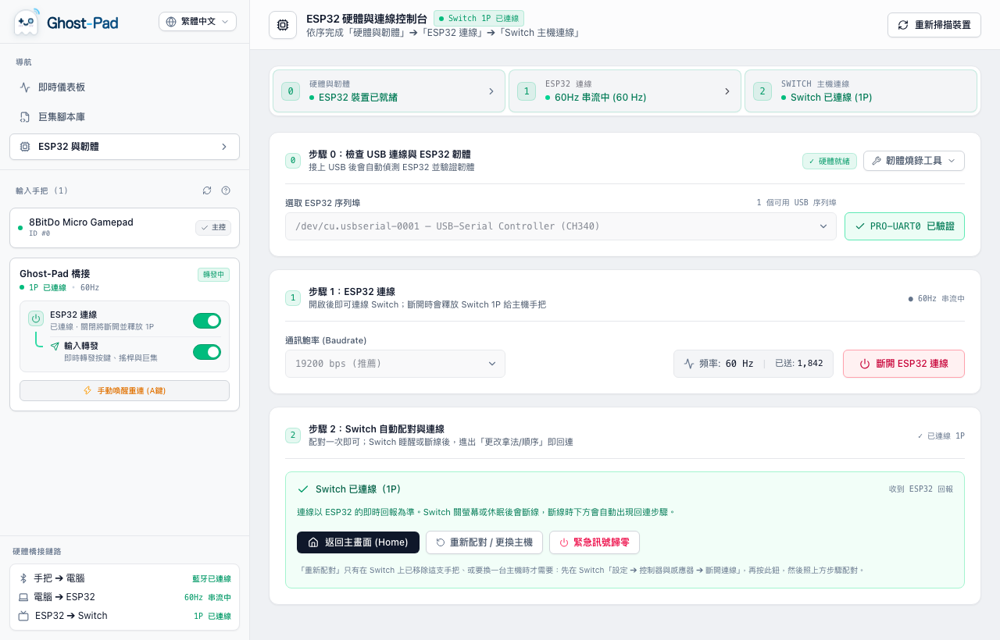

<div align="center">


# Ghost-Pad

**[English](README.md) | [繁體中文](README.zh-TW.md) | [日本語](README.ja.md)**

高效能 PC 轉 Nintendo Switch 虛擬手把橋接器、即時視覺化儀表板與巨集自動化工作坊。

[](https://tauri.app/)
[](https://react.dev/)
[](https://www.rust-lang.org/)
[](https://www.typescriptlang.org/)
[](desktop/README.md)

<br />



</div>

## 專案簡介

**Ghost-Pad** 將電腦轉變為 Nintendo Switch 的智慧控制器核心。桌面應用程式（基於 Tauri v2、Rust 與 React 19）整合實體手把、鍵盤、螢幕操作與巨集腳本的輸入，透過 USB 序列埠（`19200 bps`，UARTSwitchCon 9-Byte + CRC-8 協定）以 60Hz 串流至 ESP32 開發板，並以 Bluetooth Classic 無線模擬原廠 **Nintendo Switch Pro Controller**（`VID: 0x057E`、`PID: 0x2009`）。

```text
PC（Ghost-Pad 桌面端） ──[ USB 序列埠 19200 bps ]──▶  ESP32（Bluetooth Classic HID） ──[ 無線藍牙 ]──▶  Nintendo Switch
```

> [!NOTE]
> 本系統需搭配支援 **Bluetooth Classic (BR/EDR)** 的 ESP32 開發板使用。專案已預先整合編譯完成的韌體（`firmware/PRO-UART0.bin`），可直接在應用程式中一鍵燒錄。

## 畫面預覽

<div align="center">

| 巨集工作坊與循環播放引擎 | ESP32 硬體設定與 Switch 配對 |
| :---: | :---: |
|  |  |

</div>

## 核心特色

- **三路並行輸入橋接 (Tri-Input Bridge)**：
  - **實體手把**：透過 `gilrs` 以低延遲（< 1ms）原生輪詢 8BitDo Micro、Switch Pro Controller 與 Joy-Con（支援藍牙與 USB）。
  - **鍵盤直控**：內建 WASD 類比搖桿模擬與 Switch 動作／系統鍵位映射。
  - **螢幕觸控 / 滑鼠**：可直接點擊幽靈手把按鍵，或以 120Hz 硬體加速拖曳類比搖桿（支援 Pointer Capture 與物理彈簧回彈）。
  - **智慧狀態合併**：數位按鍵採用聯集（OR）邏輯，搖桿與十字鍵支援動態覆蓋，並提供一鍵靜音（Mute）模式防止誤觸。
- **幽靈手把視覺化與迷你 HUD 模式**：
  - 互動式幽靈造型 2D 手把，具動態表情回饋與雙搖桿角度顯示。
  - 支援自動等比縮放（Auto Scale-to-Fit），視窗縮小至 `720×460` 以下時自動切換為迷你懸浮 HUD。
- **即時輸入時序流 (Live Input Timeline)**：
  - 5 軌五線譜架構（動作鍵、十字鍵、搖桿、肩鍵、系統鍵），即時繪製長按光帶，提供 `10s` / `15s` / `30s` / `60s` 捲動速度與操作計數統計。
- **巨集工作坊與循環播放引擎**：
  - **即時差分側錄**：3-2-1 倒數緩衝，以毫秒精度記錄按鍵時長與搖桿向量。
  - **視覺化時間軸與卡片編輯器**：微調每步動作時長（`durationMs`）與間隔延遲（`delayAfterMs`），支援拖曳排序與一鍵修剪空白時間。
  - **彈性循環與安全中斷**：支援單次播放、指定次數（`2–999`）或無限循環（`∞`），可調整 `0.5x–2.0x` 速度，並提供全域 `Esc` 緊急中斷保護。
  - **範本與備份**：內建寶可夢孵蛋、動森流星許願等實用範本，支援單一腳本 JSON 匯出／匯入與全庫備份。
- **硬體與韌體管理**：
  - 自動偵測 ESP32 序列埠與晶片（CH340 / CP2102 / FTDI），並過濾虛擬藍牙序列埠。
  - 60Hz 心跳封包與 200ms 看門狗防暴走保護（Watchdog Fail-Safe），斷線時自動歸零防卡鍵。
  - 內建 Switch 配對引導、配對記憶、A / Home 鍵快速喚醒回連與一鍵韌體燒錄。
- **多語系介面**：
  - 原生支援繁體中文（`zh-TW`）、英文（`en`）與日文（`ja`），可即時切換。

## 快速開始

### 下載安裝（macOS）

一般使用者無需配置開發環境或自行編譯：

1. 前往 **[GitHub Releases](https://github.com/shihchi/ghost-pad/releases)** 頁面。
2. 下載最新的 **`Ghost-Pad_<version>_universal.dmg`**（通用版本，同時支援 Apple Silicon 與 Intel Mac）。
3. 開啟 `.dmg` 檔案，將 **Ghost-Pad** 拖入「應用程式 (Applications)」資料夾即可使用。

### ESP32 韌體燒錄

將 ESP32 透過 USB 連接至電腦後，可透過以下任一方式燒錄內建韌體：

- **應用程式內建燒錄（建議）**：開啟 Ghost-Pad 的「硬體設定」面板，點擊一鍵燒錄即可自動寫入 `firmware/PRO-UART0.bin`。
- **手動燒錄（`esptool`）**：
  ```bash
  python -m esptool --port <YOUR_PORT> --baud 460800 write-flash 0x0 firmware/PRO-UART0.bin
  ```

### 從原始碼建置

前置需求：**Node.js 18+**、**Rust 工具鏈**，以及 **Xcode Command Line Tools**（macOS）。

```bash
cd desktop
npm install
npm run tauri dev
```

> [!TIP]
> 若只想在瀏覽器中預覽或開發前端介面（不啟動 Tauri 與硬體連接），可在 `desktop/` 目錄執行 `npm run dev` 並開啟 `http://localhost:1420/`。

## 專案目錄結構

```text
ghost-pad/
├── desktop/                      # Tauri v2 + React 19 + TypeScript + Rust 桌面應用程式
│   ├── ARCHITECTURE.md           # 系統架構與元件設計規格
│   ├── README.md                 # 開發環境設定、鍵盤對照表、建置與測試指南
│   ├── src/                      # React 前端介面（視覺化、時序流、巨集工作坊、硬體設定）
│   │   ├── components/           # UI 元件與 Canvas 渲染模組
│   │   ├── hooks/                # 輸入橋接、搖桿物理、巨集錄製與播放 Hooks
│   │   └── i18n/                 # 多語系翻譯（en、zh-TW、ja）
│   └── src-tauri/                # Rust 後端（gilrs 輪詢、60Hz 序列埠傳輸、封包協定）
├── firmware/                     # 預先編譯的 ESP32 韌體
│   ├── PRO-UART0.bin             # Switch Pro Controller 藍牙模擬整合鏡像（燒錄位址 0x0）
│   └── README.md                 # 韌體燒錄說明
└── docs/                         # 通訊協定與實作規格文件
    ├── technical_spec.zh-TW.md   # 底層二進位協定（CRC-8 / XOR）與 ESP32 藍牙規格書
    ├── desktop_app_plan.zh-TW.md # 桌面系統實作規格與驗收清單
    └── assets/                   # Logo 與各語系軟體截圖
```

## 相關文件

| 文件 | 說明 |
| :--- | :--- |
| [桌面端開發與使用手冊](desktop/README.md) | 環境需求、開發模式、預設鍵盤對照表與自動化測試（109 項） |
| [系統架構手冊](desktop/ARCHITECTURE.md) | 三路輸入狀態合併演算法、元件設計與 UART 通訊流程 |
| [底層通訊與硬體協定規範](docs/technical_spec.zh-TW.md) | 9-Byte CRC-8 / 10-Byte XOR 封包格式與 ESP32 HID 實作細節 |
| [系統實作規格手冊](docs/desktop_app_plan.zh-TW.md) | 模組規格、開發里程碑與驗收清單 |
| [ESP32 韌體說明](firmware/README.md) | 預編譯韌體資訊與 `esptool` 手動燒錄指令 |
