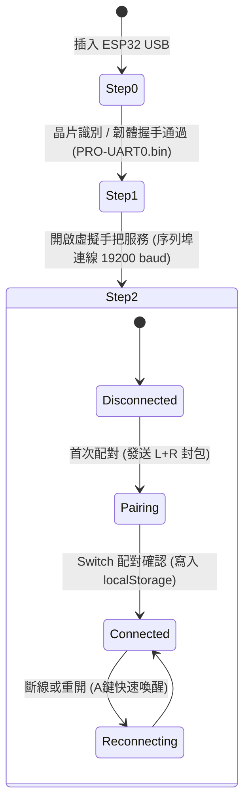

# 👻 Ghost-Pad Desktop 架構設計與開發指南 (Architecture & Maintenance Guide)

本文件詳細記錄 **Ghost-Pad Desktop** 的系統架構、資料流、核心演算法、前端元件拆分設計與硬體通訊協議，供日後維護、功能擴充與問題排查查閱。

---

## 📑 目錄

1. [系統全景架構 (System Architecture)](#1-系統全景架構-system-architecture)
2. [三路輸入並行橋接 (Tri-Input Bridge)](#2-三路輸入並行橋接-tri-input-bridge)
3. [狀態合併演算法 (State Merging Logic)](#3-狀態合併演算法-state-merging-logic)
4. [前端架構與自訂 Hooks (Frontend Architecture & Custom Hooks)](#4-前端架構與自訂-hooks-frontend-architecture--custom-hooks)
5. [即時時序流畫布 (InputTimelineStream Canvas Architecture)](#5-即時時序流畫布-inputtimelinestream-canvas-architecture)
6. [ESP32 序列埠與 Switch 握手狀態機 (Hardware & Protocol State Machine)](#6-esp32-序列埠與-switch-握手狀態機-hardware--protocol-state-machine)
7. [通訊封包格式規格 (Protocol Specifications)](#7-通訊封包格式規格-protocol-specifications)
8. [測試規範與維護指引 (Testing & Maintenance Guidelines)](#8-測試規範與維護指引-testing--maintenance-guidelines)

---

## 1. 系統全景架構 (System Architecture)

Ghost-Pad Desktop 採用 **Tauri v2 (Rust 後端)** 結合 **React 19 + TypeScript (前端)** 的混合架構：

```mermaid
graph TD
    subgraph Input Sources
        GP[實體手把\n8BitDo / Pro / JoyCon] -->|OS HID API| GILRS[Rust gilrs 輪詢線程]
        KB[電腦鍵盤\nWASD + 鍵位映射] -->|Web Key Events| VGP[useVirtualGamepad Hook]
        UI[畫面點擊 / 拖曳\nGhost-Pad / HUD] -->|Pointer Events| DRAG[useStickDrag / usePulsedButtonPress]
    end

    subgraph Rust Backend (desktop/src-tauri)
        GILRS -->|實體輸入| MERGE[GamepadManager::merge]
        VGP -->|Tauri IPC| VIRT[虛擬輸入狀態庫]
        DRAG -->|Tauri IPC| VIRT
        VIRT -->|虛擬輸入| MERGE
        MERGE --> STATE[最終合併狀態\nControllerState]
        STATE -->|Tauri Event 60Hz| FE[前端即時渲染\nVisualizer & Timeline]
        STATE -->|60Hz 發送迴圈| SER[SerialManager 心跳執行緒]
    end

    subgraph Hardware Target
        SER -->|UART 19200 baud| ESP[ESP32 開發板]
        ESP -->|藍牙 HID| SW[Nintendo Switch 主機]
    end
```

---

## 2. 三路輸入並行橋接 (Tri-Input Bridge)

系統支援三種輸入方式無縫同時作用，不會互相覆蓋或產生競爭狀態：

| 輸入來源 | 捕捉機制 | 傳輸管道 | 延遲目標 |
| :--- | :--- | :--- | :--- |
| **實體手把** | Rust `gilrs` 後端多線程輪詢 | 內部 Arc/RwLock 讀寫鎖 | < 1 ms |
| **電腦鍵盤** | 前端 `keydown` / `keyup` 事件監聽 | Tauri IPC `send_virtual_button` | < 3 ms (包含樂觀 UI 零延遲更新) |
| **螢幕觸控 / 滑鼠** | Pointer Events + Pointer Capture | Tauri IPC `send_virtual_stick` (RAF 合併) | < 3 ms (直接 DOM Transform 120Hz) |

---

## 3. 狀態合併演算法 (State Merging Logic)

位於 `desktop/src-tauri/src/gamepad.rs` 的 `GamepadManager::merge` 實作了雙路輸入合併規則：

1. **數位按鍵 (ABXY, L/R, ZL/ZR, 系統鍵, Stick Clicks)**：
   $$\text{Output Button} = \text{Physical Button} \lor \text{Virtual Button}$$
   只要任一路按下，輸出即為按下（OR 邏輯）。

2. **方向鍵 (D-Pad)**：
   - 若虛擬鍵盤或螢幕輸入產生非置中方向（`v.dpad != Center`），優先使用虛擬輸入。
   - 否則沿用實體手把方向（`p.dpad`）。

3. **類比搖桿 (Left Stick & Right Stick, 0~255, 128 為中心點)**：
   - 若虛擬端數值脫離中心區間（`v.stick != 128`），優先採用虛擬搖桿偏移。
   - 否則沿用實體手把類比量（`p.stick`）。

4. **靜音機制 (Mute Mode)**：
   - 若啟用靜音 (`is_muted = true`)，輸出狀態重置為完全中立的預設狀態 (`DEFAULT_CONTROLLER_STATE`)，停止向 Switch 傳輸任何按鍵動作。

---

## 4. 前端架構與自訂 Hooks (Frontend Architecture & Custom Hooks)

為避免複雜的指標事件、觸控捕捉與計時器在元件間重複實作，前端抽取了共用 Hooks：

### 4.1 `usePulsedButtonPress` (`src/hooks/usePulsedButtonPress.ts`)
- **目的**：處理畫面上按鍵點擊與鍵盤輔助點擊（`Space` / `Enter`）。
- **保證最小脈衝時長 (`minHoldMs = 140ms`)**：
  使用者超快速點擊（例如 20ms）時，自動拉長保持時間至 140ms，確保 Switch 主機端能正確讀取到按鈕封包，且螢幕視覺有完整光暈回饋。
- **生命週期安全性**：元件卸載（Unmount）時自動清空所有尚未執行的 `setTimeout`，杜絕記憶體洩漏與未掛載狀態更新。
- **提供方法**：
  - `handleButtonPress(buttonName: string, pressed: boolean)`
  - `bindButton(buttonName: string)`：回傳包含 `onPointerDown`, `onPointerUp`, `onPointerCancel`, `onClick` 的屬性包。

### 4.2 `useStickDrag` (`src/hooks/useStickDrag.ts`)
- **目的**：提供滑鼠 / 觸控於類比搖桿底座上的拖曳體驗。
- **功能特點**：
  - **Pointer Capture**：拖曳超出搖桿範圍時不中斷追蹤。
  - **120Hz 直接硬體加速 DOM 更新**：不透過 React setState，以 `translate3d` 達成零延遲跟手感。
  - **RAF IPC 節流**：在 60Hz requestAnimationFrame 內合併位移量，避免高頻拖曳時塞滿 Tauri IPC 佇列。
  - **彈力回彈動畫**：釋放時透過 `cubic-bezier(0.18, 0.89, 0.32, 1.28)` 達成真實手把彈回的物理微彈跳。
  - **原地點擊判定 (L3/R3 Click)**：若點擊移動位移小於門檻值（5~6px），自動觸發一次搖桿下壓（L3/R3）。
  - **RWD 縮放補償 (`getScale`)**：支援外層 CSS scale 自動補償滑鼠移動距離。

### 4.3 `useVirtualGamepad` (`src/hooks/useVirtualGamepad.ts`)
- **目的**：鍵盤事件至手把按鍵的映射與 WASD 類比搖桿推動計算。
- **D-Pad 8 向演算法 (`computeDpadVal`)**：
  ```
  0: 上, 1: 右上, 2: 右, 3: 右下, 4: 下, 5: 左下, 6: 左, 7: 左上, 8: 中立
  ```
  若同時按下相反方向（如上+下或左+右），演算法自動消除衝突回傳中立 (8)。

---

## 5. 即時時序流畫布 (InputTimelineStream Canvas Architecture)

`InputTimelineStream.tsx` 提供仿 DAW / 節奏遊戲音樂五線譜的 60~120Hz 畫布：

```
[頂部時間標尺] 0s ─── 5s ─── 10s ─── 15s ─── 20s ─── 25s ─── 30s
┌──────────────────────────────────────────────────────────────┐
│ [ABXY]  │  (A)======     (B)   (X)========                   │
│ [十字鍵] │         [▲]====                                   │
│ [搖桿]  │   [L▶]======       [L▲]========                    │
│ [肩鍵]  │  (ZL)===                                           │
│ [系統]  │              (⌂)                                   │
└──────────────────────────────────────────────────────────────┘
[左側軌道名]  ▲ 0s 打擊線 (Playhead Line)
```

- **軌道結構**：
  - 第 0 軌：ABXY 動作鍵（綠/紅/天藍/琥珀黃）
  - 第 1 軌：十字鍵 D-Pad（紫色）
  - 第 2 軌：搖桿與下壓 L3/R3（青色/藍綠）
  - 第 3 軌：肩鍵 L/R/ZL/ZR（粉紅/玫瑰紅）
  - 第 4 軌：系統鍵 Minus/Plus/Home/Capture（石板灰/天藍）
- **渲染優化**：
  - 純靜態 `getButtonStates` 提取器移至元件外部，避免每次渲染重複配置。
  - Canvas 針對 Retina 螢幕支援 `devicePixelRatio` 縮放，線條極致銳利。
  - 邊緣漸層遮罩 (`fadeGrad`) 確保音符流出邊界時自然淡出。

---

## 6. ESP32 序列埠與 Switch 握手狀態機 (Hardware & Protocol State Machine)

硬體連線採「嚴格順序式三步管理 (Sequential Three-Step Management)」：



- **步驟 0**：自動過濾無效序列埠（macOS 藍牙虛擬埠、tty 重複埠），優先識別 CH340 / CP2102 / FTDI 等 ESP32 晶片。
- **步驟 1**：開關 60Hz 心跳封包傳輸線程。
- **步驟 2**：
  - 首次配對：發送 `pair_lr` 指令，成功後將狀態記憶於 `localStorage`。
  - 後續開機：連線後自動送出 `wake_reconnect` 指令喚醒 Switch。

---

## 7. 通訊封包格式規格 (Protocol Specifications)

本專案支援兩種 PC 至 ESP32 封包協定（定義於 `desktop/src-tauri/src/protocol.rs`）：

### 7.1 UARTSwitchCon 9-Byte 封包 (預設標準)

| Offset | 欄位 | 說明 |
| :--- | :--- | :--- |
| `0` | Header | `0xFF` 固定開頭碼 |
| `1` | Button Low | 按鍵狀態低位元（按鍵按下為 `0` 反向邏輯） |
| `2` | Button High | 按鍵狀態高位元 |
| `3` | D-Pad | 十字鍵 0~8 |
| `4` | Left Stick X | 0~255 (128 置中) |
| `5` | Left Stick Y | 0~255 (128 置中) |
| `6` | Right Stick X | 0~255 (128 置中) |
| `7` | Right Stick Y | 0~255 (128 置中) |
| `8` | CRC-8 | 多項式 `0x07` (初始值 `0x00`) 校驗和 |

### 7.2 Custom 10-Byte XOR 封包

| Offset | 欄位 | 說明 |
| :--- | :--- | :--- |
| `0` | Header 0 | `0xAA` |
| `1` | Header 1 | `0x55` |
| `2` | Button Low | 按鈕位元遮罩 |
| `3` | Button High | 系統鍵與 Stick Click 遮罩 |
| `4` | D-Pad | 0~8 |
| `5..8` | Sticks | LX, LY, RX, RY (0~255) |
| `9` | Checksum | 前 9 位元組之 XOR 逐位異或值 |

---

## 8. 測試規範與維護指引 (Testing & Maintenance Guidelines)

### 8.1 執行測試

```bash
# 1. 前端測試 (71 項全通)
cd desktop
npm test

# 2. 前端編譯檢查
npm run build

# 3. Rust 後端測試 (18 項全通)
cd src-tauri
cargo test
```

### 8.2 開發維護注意事項

1. **不可修改現有測試檔斷言**：所有重構必須在維持既有單元測試完全相容的前提下進行。
2. **非同步卸載保護**：任何含有 `setTimeout` 或非同步 IPC 呼叫的 React 元件，必須確認掛載狀態或於卸載回呼中清理計時器。
3. **高頻 IPC 控制**：搖桿類比量更新務必透過 `requestAnimationFrame` 進行節流，切勿於每一像素移動時直接呼叫 IPC。

---

## 9. 巨集腳本庫與回放系統 (Phase 3: Macro Studio & Playback)

### 9.1 動作差分側錄演算法 (`useMacroRecorder.ts`)
- **倒數緩衝 (3-2-1 Countdown)**：按下側錄按鈕後觸發 3 秒倒數計時，讓操作者握妥實體手把或就位鍵盤。
- **差分捕捉 (Delta/Action-Based Recording)**：
  - 數位鍵：按壓瞬間記錄 `startTime`，鬆開時結算持續時長 `durationMs` 與間隔時間 `delayAfterMs`。
  - 類比搖桿：超出死區門檻 (`STICK_DEADZONE = 25`) 時開始計時並記錄推動向量，回彈時打包為 `MacroAction`。
  - 十字鍵：非中立 (8) 時記錄方向與持長。
- **儲存對話框 (`SaveMacroModal.tsx`)**：錄製完成後可自訂名稱、備註說明與分類標籤（如 `#寶可夢`、`#動森`、`#連點`）。

### 9.2 腳本庫管理與持久化 (`macroStorage.ts`)
- **預設腳本 (Presets)**：內建寶可夢自動孵蛋 (Infinite Spin)、動森流星許願 (Auto A Spam)、薩爾達林克時間 (Bullet Time Aim)。
- **JSON 匯入/匯出**：支援單一腳本匯出 (`.json`) 與全腳本備份 (`ghostpad_macros_backup_*.json`)，支援拖曳上傳與自動驗證修復。
- **修剪頭尾 (Trim Actions)**：一鍵清除無效空檔與頭尾靜止幀。

### 9.3 循環回放與安全中斷 (`useMacroPlayer.ts`)
- **循環控制**：支援「單次播放」、「循環 N 次 (2~999 次)」與「∞ 無限循環」。
- **倍速調控**：支援 0.5x、1.0x、1.5x、2.0x 動作調速。
- **緊急保護 (Emergency Fail-Safe)**：
  - 鍵盤按下 `Esc` 或點擊「緊急中止」按鈕，立即清除所有 pending timers 並調用 `reset_virtual_inputs`，防止手把卡鍵。

