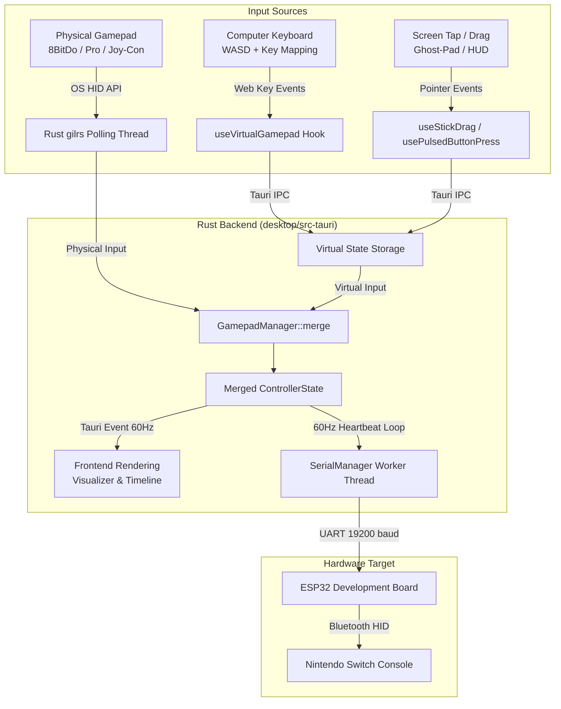
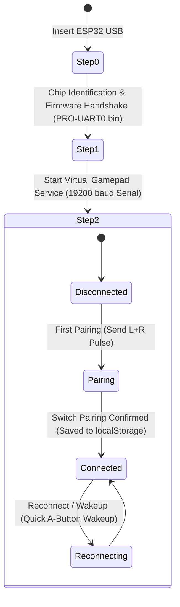

# 👻 Ghost-Pad Desktop Architecture & Developer Guide

This document provides a comprehensive technical overview of **Ghost-Pad Desktop**, detailing its system architecture, data flow, core algorithms, frontend component design, and hardware communication protocols for maintenance, future extension, and debugging.

---

## 📑 Table of Contents

1. [System Architecture](#1-system-architecture)
2. [Tri-Input Bridge](#2-tri-input-bridge)
3. [State Merging Logic](#3-state-merging-logic)
4. [Frontend Architecture & Custom Hooks](#4-frontend-architecture--custom-hooks)
5. [Live Timeline Stream Canvas Architecture](#5-live-timeline-stream-canvas-architecture)
6. [ESP32 Serial Port & Switch Handshake State Machine](#6-esp32-serial-port--switch-handshake-state-machine)
7. [Protocol Specifications](#7-protocol-specifications)
8. [Testing & Maintenance Guidelines](#8-testing--maintenance-guidelines)
9. [Macro Studio & Playback Engine](#9-macro-studio--playback-engine)

---

## 1. System Architecture

Ghost-Pad Desktop employs a hybrid architecture built upon **Tauri v2 (Rust backend)** and **React 19 + TypeScript (frontend)**:



---

## 2. Tri-Input Bridge

The system seamlessly combines three concurrent input sources without race conditions or state overwriting:

| Input Source | Capture Mechanism | Transport Channel | Latency Target |
| :--- | :--- | :--- | :--- |
| **Physical Gamepad** | Multi-threaded polling via Rust `gilrs` | Internal `Arc<RwLock<...>>` lock | < 1 ms |
| **Computer Keyboard** | Frontend `keydown` / `keyup` event listeners | Tauri IPC `send_virtual_button` | < 3 ms (with optimistic zero-latency UI update) |
| **Touch / Mouse Pointer** | Pointer Events + Pointer Capture | Tauri IPC `send_virtual_stick` (RAF throttled) | < 3 ms (direct 120Hz DOM transforms) |

---

## 3. State Merging Logic

Located in `desktop/src-tauri/src/gamepad.rs`, `GamepadManager::merge` implements multi-source merging rules:

1. **Digital Buttons (ABXY, L/R, ZL/ZR, System Buttons, Stick Clicks)**:
   $$\text{Output Button} = \text{Physical Button} \lor \text{Virtual Button}$$
   If a button is pressed from either source, the output state is pressed (logical OR).

2. **D-Pad Direction**:
   - If virtual inputs (keyboard or UI) report a non-neutral direction (`v.dpad != Center`), virtual input takes precedence.
   - Otherwise, the physical controller direction (`p.dpad`) is preserved.

3. **Analog Sticks (Left Stick & Right Stick: 0~255, 128 is center)**:
   - If the virtual stick deflects away from neutral (`v.stick != 128`), the virtual offset takes precedence.
   - Otherwise, the physical analog magnitude (`p.stick`) is used.

4. **Mute Mode**:
   - When muted (`is_muted = true`), the output state is forced to a completely neutral state (`DEFAULT_CONTROLLER_STATE`), stopping all inputs to the Switch.

---

## 4. Frontend Architecture & Custom Hooks

To avoid duplicate implementations of pointer capture, gesture tracking, and asynchronous timers across components, the frontend encapsulates reusable hooks:

### 4.1 `usePulsedButtonPress` (`src/hooks/usePulsedButtonPress.ts`)
- **Purpose**: Handles on-screen button taps and accessibility keyboard triggers (`Space` / `Enter`).
- **Guaranteed Minimum Pulse Duration (`minHoldMs = 140ms`)**:
  When a user performs an ultra-fast tap (e.g., 20ms), the duration is automatically extended to 140ms to guarantee that the Switch console registers the packet and the UI displays full glow feedback.
- **Lifecycle Safety**: Cancels all pending `setTimeout` callbacks upon component unmount to prevent memory leaks and state updates on unmounted components.
- **Provided API**:
  - `handleButtonPress(buttonName: string, pressed: boolean)`
  - `bindButton(buttonName: string)`: Returns props containing `onPointerDown`, `onPointerUp`, `onPointerCancel`, and `onClick`.

### 4.2 `useStickDrag` (`src/hooks/useStickDrag.ts`)
- **Purpose**: Delivers smooth mouse/touch dragging on the analog stick bases.
- **Key Features**:
  - **Pointer Capture**: Ensures continuous tracking even when dragging extends beyond the stick bounds.
  - **120Hz Direct Hardware-Accelerated DOM Updates**: Bypasses React `setState` during active dragging, applying `translate3d` directly for zero-latency tracking.
  - **RAF IPC Throttling**: Batches coordinate changes within a 60Hz `requestAnimationFrame` loop to prevent overloading the Tauri IPC channel.
  - **Spring-Back Physics**: Smoothly animates release back to center with `cubic-bezier(0.18, 0.89, 0.32, 1.28)`.
  - **In-Place Click Detection (L3/R3)**: If displacement upon release is under threshold (5~6px), it triggers a stick press (L3/R3 click).
  - **RWD Scale Compensation (`getScale`)**: Compensates for CSS scale transforms on the parent container when calculating pointer coordinates.

### 4.3 `useVirtualGamepad` (`src/hooks/useVirtualGamepad.ts`)
- **Purpose**: Maps keyboard events to virtual gamepad inputs and computes WASD analog stick emulation.
- **D-Pad 8-Way Algorithm (`computeDpadVal`)**:
  ```
  0: Up, 1: Up-Right, 2: Right, 3: Down-Right, 4: Down, 5: Down-Left, 6: Left, 7: Up-Left, 8: Neutral
  ```
  Conflicting opposing keys (such as Up + Down or Left + Right) automatically resolve to Neutral (8).

---

## 5. Live Timeline Stream Canvas Architecture

`InputTimelineStream.tsx` provides a 60~120Hz canvas visualizer reminiscent of a DAW piano roll or rhythm game score sheet:

```
[Time Ruler] 0s ─── 5s ─── 10s ─── 15s ─── 20s ─── 25s ─── 30s
┌──────────────────────────────────────────────────────────────┐
│ [ABXY]     │  (A)======     (B)   (X)========                │
│ [D-Pad]    │         [▲]====                                 │
│ [Sticks]   │   [L▶]======       [L▲]========                 │
│ [Shoulder] │  (ZL)===                                        │
│ [System]   │              (⌂)                                │
└──────────────────────────────────────────────────────────────┘
[Track Names] ▲ 0s Playhead Line
```

- **Track Layout**:
  - Track 0: Action Buttons ABXY (Green / Red / Sky Blue / Amber)
  - Track 1: D-Pad Directions (Purple)
  - Track 2: Analog Sticks & Clicks L3/R3 (Cyan / Teal)
  - Track 3: Shoulder Buttons L / R / ZL / ZR (Pink / Rose)
  - Track 4: System Buttons Minus / Plus / Home / Capture (Slate / Sky Blue)
- **Rendering Optimizations**:
  - Pure static `getButtonStates` extractor is placed outside the component to prevent allocations during render loops.
  - Supports Retina high-DPI rendering via `devicePixelRatio` scaling.
  - Edge gradient mask (`fadeGrad`) smoothly dissolves notes as they pass beyond the viewport boundary.

---

## 6. ESP32 Serial Port & Switch Handshake State Machine

Hardware communication follows a strict three-stage sequential flow:



- **Step 0**: Automatically filters out invalid ports (macOS virtual Bluetooth ports, duplicate tty entries) and prioritizes ESP32 chips (CH340, CP2102, FTDI).
- **Step 1**: Controls the 60Hz heartbeat transmission worker thread.
- **Step 2**:
  - **First-time Pairing**: Sends `pair_lr` command, saving state to `localStorage` upon success.
  - **Subsequent Boot**: Sends `wake_reconnect` command upon serial connection to wake up the Switch.

---

## 7. Protocol Specifications

The project supports two PC-to-ESP32 protocols (defined in `desktop/src-tauri/src/protocol.rs`):

### 7.1 UARTSwitchCon 9-Byte Packet (Default Standard)

| Offset | Field | Description |
| :--- | :--- | :--- |
| `0` | Header | Fixed identifier `0xFF` |
| `1` | Button Low | Lower action button bitmask (active low `0`) |
| `2` | Button High | Upper action and system button bitmask |
| `3` | D-Pad | Directional index (0~8) |
| `4` | Left Stick X | 0~255 (128 centered) |
| `5` | Left Stick Y | 0~255 (128 centered) |
| `6` | Right Stick X | 0~255 (128 centered) |
| `7` | Right Stick Y | 0~255 (128 centered) |
| `8` | CRC-8 | Polynomial `0x07` (initial value `0x00`) checksum |

### 7.2 Custom 10-Byte XOR Packet (Legacy Compatibility)

| Offset | Field | Description |
| :--- | :--- | :--- |
| `0` | Header 0 | Fixed header byte `0xAA` |
| `1` | Header 1 | Fixed header byte `0x55` |
| `2` | Button Low | Action button bitmask |
| `3` | Button High | System and stick click bitmask |
| `4` | D-Pad | Directional index (0~8) |
| `5..8` | Sticks | LX, LY, RX, RY (0~255) |
| `9` | Checksum | Bitwise XOR sum across the first 9 bytes |

---

## 8. Testing & Maintenance Guidelines

### 8.1 Running Test Suites

```bash
# 1. Frontend Tests (89 tests passing)
cd desktop
npm test

# 2. Frontend Production Build Check
npm run build

# 3. Rust Backend Tests (20 tests passing)
cargo test --manifest-path src-tauri/Cargo.toml
```

### 8.3 Release & Tagging Workflow

Pushing a version tag (e.g. `v1.0.0`) triggers the automated GitHub Actions release workflow:
1. Synchronizes version numbers across `package.json` and `Cargo.toml`.
2. Runs all 89 frontend and 20 backend unit tests.
3. Builds the universal macOS binary (`.dmg` supporting both Apple Silicon and Intel).
4. Publishes installer and `.zip` archives directly to **GitHub Releases**.

```bash
git tag v1.0.0
git push origin v1.0.0
```

---

## 9. Macro Studio & Playback Engine

### 9.1 Timeline Relative Offset Recording (`useMacroRecorder.ts`)
- **3-2-1 Countdown Buffer**: Triggers a 3-second animated countdown before recording begins, allowing the user to prepare hands on the physical controller or keyboard.
- **Timeline Relative Offset & Concurrent Capture**:
  - Digital Buttons: Records relative `startTimeMs` on press; computes duration (`durationMs`) on release. Supports multiple simultaneous buttons down with overlapping intervals.
  - Analog Sticks: Begins tracking once deflection exceeds deadzone, storing vector, `startTimeMs`, and duration into a `MacroAction` when returning to neutral.
  - D-Pad: Captures relative timestamp, direction, and hold duration whenever non-neutral (0~7).
- **Concurrent Timeline Preservation**: Preserves exact temporal overlap across all tracks without flattening inputs into artificial sequential wait steps.
- **Save Modal (`SaveMacroModal.tsx`)**: Allows custom name, description notes, and metadata tags upon recording completion.

### 9.2 Script Persistence & Management (`macroStorage.ts`)
- **Built-in Presets**: Pre-packaged automation routines (Infinite Spin for Pokemon egg hatching, Auto-A Spam for Animal Crossing, Concurrent ZR + Rapid A Aim for Zelda).
- **JSON Import / Export**: Supports individual `.json` script downloads, batch backup files (`ghostpad_macros_backup_*.json`), and drag-and-drop validation.
- **Timeline Scheduling**: Computes start/end timestamps directly from `startTimeMs` and `durationMs`, supporting simultaneous actions across tracks.

### 9.3 Concurrent Playback Engine & Fail-Safe Protection (`useMacroPlayer.ts`)
- **Concurrent Event Scheduler**:
  - Dispatches discrete activate and deactivate events at `startTimeMs / speedMultiplier` and `(startTimeMs + durationMs) / speedMultiplier`.
  - **Button Lease Counting**: Tracks active concurrent references for each button. A release signal is only issued when the active lease count drops to zero, preventing race conditions during overlapping presses.
- **Playback Controls**: Supports Single Play, N-Iteration Loops (2~999), and Infinite ($\infty$) Loop modes with configurable `loopDelayMs`.
- **Speed Multipliers**: Configurable playback speeds (0.5x, 1.0x, 1.5x, 2.0x).
- **Emergency Fail-Safe Abort**:
  - Pressing the `Esc` key on the keyboard or clicking the "Emergency Abort" button immediately clears all pending timers and issues `reset_virtual_inputs`, releasing all controller keys to prevent sticky inputs.
