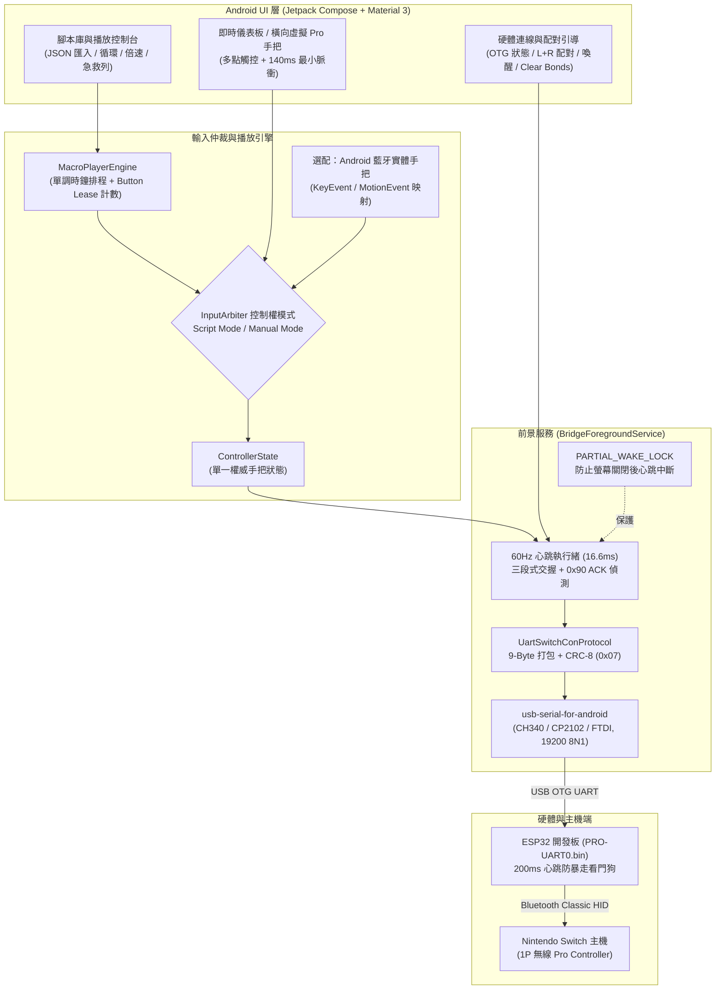
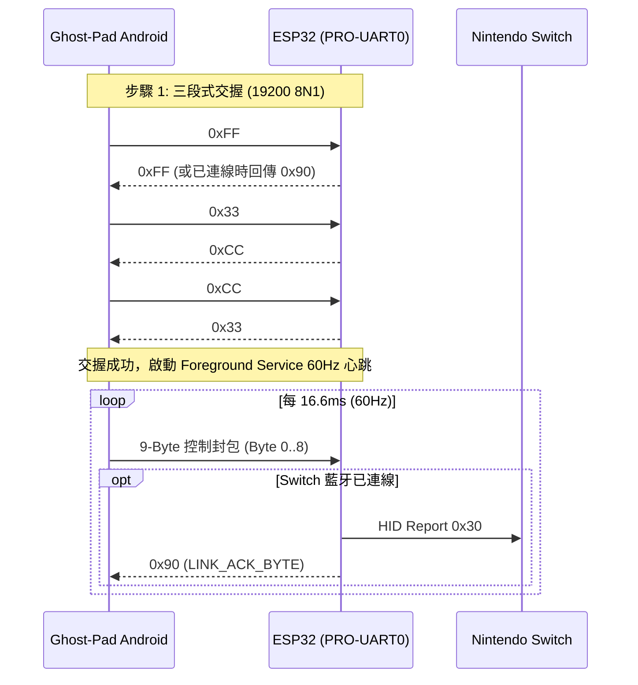
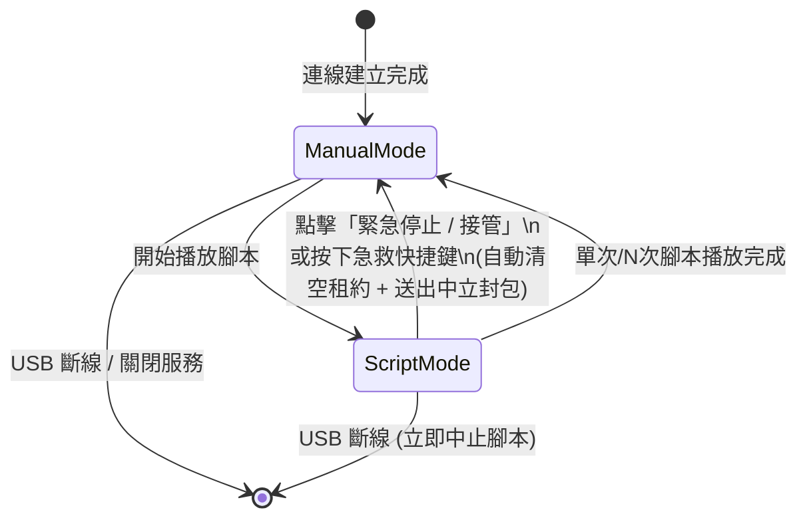

# 📱 Ghost-Pad Android: 系統架構與開發規劃書 (Android App Plan)

本文件為 **Ghost-Pad Android 版** 的完整系統架構、通訊協定對齊規格、即時儀表板與分階段開發規劃書。規劃目標是打造一款輕量、穩定、可直接沿用現有 ESP32 韌體（[`firmware/PRO-UART0.bin`](../firmware/PRO-UART0.bin)）與桌面版巨集腳本的原生 Android 應用程式。

> **文件語系說明**：目前先維護繁體中文規劃版，待 Android 核心功能開發收斂後，再比照 [`desktop_app_plan.zh-TW.md`](desktop_app_plan.zh-TW.md) 補齊英文與日文版本。

---

## 🎯 一、專案定位與核心目標

1. **零修改沿用現有硬體鏈路**：透過手機 **USB OTG (USB Host Mode)** 直接連接已燒錄 `PRO-UART0.bin` 的 ESP32，走既有 **19200 bps / UARTSwitchCon 9-Byte + CRC-8** 協定控制 Nintendo Switch，不需改動任何 ESP32 韌體。
2. **長時間穩定掛機播放腳本**：完整相容桌面版匯出的 `.json` 單一腳本與全庫備份檔，並以 Android **Foreground Service** 與喚醒鎖抵抗系統休眠（Doze Mode），避免觸發 ESP32 200ms 看門狗斷線。
3. **解決限定 1P 遊戲的突發操作痛點**：當 ESP32 佔用 Switch 1P 導致實體手把失效時，手機端內建**即時儀表板、急救快捷列與橫向虛擬 Pro 手把**，遇到色違、意外對話框或需要手動存檔時，可一鍵緊急停止腳本並立即接管 1P 操作主機。

---

## 🏗️ 二、系統全景架構與技術棧

### 2.1 系統架構圖



### 2.2 技術棧選型與決策理由

| 項目 | 選型 | 理由與備註 |
| :--- | :--- | :--- |
| **開發框架** | **原生 Kotlin 2.x + Jetpack Compose (Material 3)** | 桌面版雖使用 Tauri v2，但 Android 沙盒無法讓 Rust `serialport` 直接開啟 `/dev/ttyUSB*`（必須走 Java/Kotlin `UsbManager`），且 WebView 計時器在背景易被休眠節流。採用原生 Kotlin 可避開跨層橋接與背景休眠問題，最穩定且維護成本最低。 |
| **USB 序列通訊** | `com.github.mik3y:usb-serial-for-android` | 社群最成熟之 Android USB-UART 驅動套件，開箱支援 ESP32 常見晶片（CH340、CP2102、FTDI、CDC/ACM）。 |
| **非同步與狀態** | Kotlin Coroutines + `StateFlow` / `SharedFlow` | 與 Compose 無縫整合，高頻狀態更新不卡主執行緒。 |
| **JSON 序列化** | `kotlinx.serialization` | 直接反序列化桌面版匯出的 `MacroScript` JSON，無需額外轉檔。 |
| **本地持久化** | DataStore Preferences + App 私有目錄 JSON 儲存 | 輕量無需架設複雜 ORM，直接保存腳本庫與使用者偏好設定。 |
| **SDK 版本** | `minSdk = 26` (Android 8.0) / `targetSdk = 35` (Android 15) | 涵蓋 95%+ 現役與備用 Android 裝置，完整支援通知頻道與現代 USB Host API。 |
| **專案目錄** | Repo 根目錄 `android/` | 與現有 `desktop/`、`firmware/`、`docs/` 並列管理。 |

---

## 🔌 三、底層通訊協定規格（與桌面版 100% 對齊）

Android 端完整實作桌面版 [`protocol.rs`](../desktop/src-tauri/src/protocol.rs) 與 [`serial.rs`](../desktop/src-tauri/src/serial.rs) 的行為規範：

### 3.1 序列埠初始化與防重置保護
- **通訊參數**：`19200 bps`、`8 Data Bits`、`No Parity`、`1 Stop Bit` (`8N1`)。
- **防 ESP32 重啟**：開啟 USB Serial Port 後立即明確設定 `dtr = false`、`rts = false`，等待 `150ms` 穩定並清空緩衝區，避免觸發 ESP32 自動重置導致與 Switch 藍牙斷線。

### 3.2 三段式交握與 60Hz 心跳狀態機
連線建立時執行強制三段式交握（重試延遲序列：`[0, 250, 450, 700] ms`）：



- **Switch 連線狀態判定**：
  - 每次發送封包後以非阻塞/短逾時（`1ms`）讀取回應；收到 `0x90` 視為 Switch 連線中（`connected`）。
  - 若超過 `1500ms` 未收到 `0x90`，判定為未連線（`pairing` / `disconnected`）。
  - 未連線期間，每 `3000ms` 自動脈衝 `250ms` 的 `L + R`，讓處於「更改拿法 / 順序」畫面的 Switch 快速配對。

### 3.3 UARTSwitchCon 9-Byte 封包格式

| Offset | 欄位 | 規格定義 |
| :---: | :--- | :--- |
| **Byte 0** | `btn_hi` | Bit 0: Minus, Bit 1: Plus, Bit 2: L3, Bit 3: R3, Bit 4: Home, Bit 5: Capture, Bit 6~7: `0` |
| **Byte 1** | `btn_lo` | Bit 0: Y, Bit 1: B, Bit 2: A, Bit 3: X, Bit 4: L, Bit 5: R, Bit 6: ZL, Bit 7: ZR |
| **Byte 2** | `dpad` | `0`=上, `1`=右上, `2`=右, `3`=右下, `4`=下, `5`=左下, `6`=左, `7`=左上, `8`=中立 (Center) |
| **Byte 3** | `left_stick_x` | `0..255`（`128` 為中心） |
| **Byte 4** | `left_stick_y` | Y 軸反轉：`255 - app_y`（`128` 映射為 `127`） |
| **Byte 5** | `right_stick_x` | `0..255`（`128` 為中心） |
| **Byte 6** | `right_stick_y` | Y 軸反轉：`255 - app_y`（`128` 映射為 `127`） |
| **Byte 7** | `reserved` | 固定 `0x00` |
| **Byte 8** | `crc8` | 對 Byte 0~7 計算 CRC-8（多項式 `0x07`、初始值 `0x00`；標準驗證向量 `"123456789"` ➔ `0xF4`） |

### 3.4 特殊控制指令
- **`PairLR`**：連續發送 15 幀 `L + R`（約 250ms），隨後 3 幀全中立。
- **`WakeReconnect`**：連續發送 10 幀 `Home`（約 160ms）喚醒休眠中的 Switch，隨後 3 幀全中立。
- **`EmergencyNeutral`**：連續發送 5 幀全中立封包（間隔 10ms），用於緊急中止與安全斷線。
- **`ClearBonds`**：發送 3 位元組 `[0xEE, 0xEE, 0xEE]` 清除 ESP32 藍牙配對記憶。

---

## 📜 四、腳本格式與回放引擎（與桌面版互通）

### 4.1 JSON 資料格式相容性
直接相容桌面版 [`macro.ts`](../desktop/src/types/macro.ts) 與 [`macroStorage.ts`](../desktop/src/utils/macroStorage.ts) 的結構：

```json
{
  "id": "macro_example",
  "name": "寶可夢自動孵蛋",
  "description": "無限旋轉",
  "createdAt": 1700000000000,
  "updatedAt": 1700000000000,
  "actions": [
    {
      "id": "act_1",
      "type": "button",
      "button": "a",
      "startTimeMs": 0,
      "durationMs": 150
    },
    {
      "id": "act_2",
      "type": "stick",
      "stick": "left",
      "stickX": 255,
      "stickY": 128,
      "startTimeMs": 200,
      "durationMs": 1000
    }
  ]
}
```

透過 Android SAF（`ActivityResultContracts.OpenDocument`）匯入檔案時，自動辨識三種桌面版格式：
1. **單一腳本 JSON**：含 `actions: [...]` 陣列。
2. **全庫備份 JSON**（`ghostpad_macros_backup_*.json`）：含 `macros: [...]` 陣列，一次批次匯入。
3. **純腳本陣列 JSON**：根節點為 `[MacroScript, ...]`。

### 4.2 並行排程回放引擎 (`MacroPlayerEngine`)
- **單調時鐘排程**：採用 `SystemClock.elapsedRealtime()` 計算所有動作的 `activateAt`（`startTimeMs / speedMultiplier`）與 `deactivateAt`（`(startTimeMs + durationMs) / speedMultiplier`），不受系統時區或時間同步影響。
- **Button Lease 計數機制**：移植桌面版 [`useMacroPlayer.ts`](../desktop/src/hooks/useMacroPlayer.ts) 的租約參考計數（Reference Counting），多筆重疊動作共用同一顆按鍵時，僅於最後一個租約到期才釋放按鍵，避免搶放。
- **回放設定**：支援單次播放 (`once`)、指定次數 (`count`: 2~999)、無限循環 (`infinite`)、循環間隔 `loopDelayMs`、以及四段倍速（`0.5x / 1.0x / 1.5x / 2.0x`）。
- **防卡鍵保護**：暫停、停止、腳本播畢或 USB 拔線時，立即清空所有租約與排程，並觸發 `EmergencyNeutral`。

---

## 🎮 五、限定 1P 遊戲：即時儀表板與突發接管設計

針對 Switch 限定 1P 遊戲中「ESP32 佔住 1P 導致原本實體手把失效」的實戰需求，設計明確且防誤觸的 **雙模式控制權仲裁器 (`InputArbiter`)**：



### 5.1 播放頁內建「急救快捷列」
在腳本播放畫面底部常駐顯示，無需切換頁面即可應對突發狀況：
- **大面積紅色「緊急停止並接管」按鈕**：一按立即停掉腳本並切入 Manual Mode。
- **急救系統鍵**：`Home`（立刻回 Switch 主畫面保命）、`Capture`（色違截圖/錄影）、`+`（開遊戲選單存檔）、`A` / `B`（快速點掉對話框）。若在腳本播放中直接點擊任一急救鍵，系統自動先停腳本再送出該按鍵脈衝。

### 5.2 橫向全螢幕「即時虛擬 Pro 手把」
- **介面佈局**：
  - 左側：虛擬左類比搖桿（拖曳回彈 + 中心歸零）＋ 8 向十字鍵（D-Pad）
  - 右側：ABXY 按鍵群 ＋ 虛擬右類比搖桿
  - 頂部肩鍵與系統列：`ZL / L / - / Capture / Home / + / R / ZR`
  - 頂部狀態膠囊：即時顯示 `Switch 連線燈號`、`TX FPS`、`目前控制模式`
- **手感與可靠性細節**：
  - **140ms 最小按壓脈衝保護**（對應桌面版 [`usePulsedButtonPress.ts`](../desktop/src/hooks/usePulsedButtonPress.ts)）：輕觸點擊過短時自動延長至 140ms，確保 Switch 穩定吃鍵。
  - **獨立多點觸控（Multi-touch）**：使用 Jetpack Compose `pointerInput` 個別追蹤多個手指 ID，支援一邊推搖桿移動、一邊按 ABXY / 肩鍵。
  - **即時視覺與觸覺回饋**：按壓瞬間給予 Haptic Feedback 與高亮回饋，確認輸出狀態。

### 5.3 進階擴充：Android 藍牙實體手把直通（Phase 4）
- 攔截 Android 原生 `KeyEvent` 與 `MotionEvent`（來源為 `SOURCE_GAMEPAD` / `SOURCE_JOYSTICK`）。
- 支援使用者透過藍牙將 Switch Pro / 8BitDo / Xbox 手把連到 Android 手機，在 Manual Mode 下直接以實體手把接管 1P 控制 Switch，獲得與桌面版一致的操作手感。

---

## 🛡️ 六、Android 系統級穩定性與避坑指南

| 風險點 | 具體影響 | 解決方案 |
| :--- | :--- | :--- |
| **鎖屏 / Doze Mode 休眠** | 螢幕關閉後系統節流執行緒與計時器，導致超過 200ms 未送心跳、ESP32 觸發看門狗斷開。 | 1. 將 USB 通訊、60Hz 心跳與腳本引擎全部放在 **`BridgeForegroundService`**（宣告 `foregroundServiceType="connectedDevice"`）。<br>2. 連線期間申請 `PARTIAL_WAKE_LOCK`，斷線時立即釋放。<br>3. 通知列常駐顯示目前連線狀態、循環進度與「緊急停止」按鈕。<br>4. 設定頁引導使用者開啟「不受電池最佳化限制」並提供「播放時螢幕常亮」開關。 |
| **開啟埠觸發 ESP32 重啟** | 連線瞬間 DTR/RTS 拉低會讓 ESP32 Reset，導致剛配對好的 Switch 斷線。 | 開啟 `UsbSerialPort` 後強制設 `dtr = false`, `rts = false`，並實作類似桌面版 `HeldPort` 的單一連線持有機制，不重複開關埠。 |
| **USB OTG 拔線 / 權限遺失** | 拔除 OTG 線未妥善清理會導致 `IOException` 迴圈或背景服務卡死。 | 註冊 `ACTION_USB_DEVICE_DETACHED` 廣播接收器，拔線瞬間中止腳本、釋放 WakeLock、關閉前景服務；透過 `res/xml/device_filter.xml` 預先過濾 CH340 (`0x1A86`) / CP2102 (`0x10C4`) / FTDI (`0x0403`) / Espressif (`0x303A`) 簡化插拔授權流程。 |
| **OTG 手機供電不足** | ESP32 藍牙發射峰值電流（200~300mA+）在部分手機或劣質轉接線上可能造成 Brownout 重啟。 | UI 偵測到短時間連續交握失敗或非預期斷線時，提示使用者檢查 OTG 線材或改用帶供電的 USB-C Hub。 |
| **手機端韌體燒錄容錯 (Phase 4)** | 部分 CH340/CP2102 開發板自動進 Bootloader 時序不一，且高鮑率寫入 Flash 在 OTG 下易掉包。 | 預設以穩定的 `115200` baud 搭配 ROM 原生 zlib 壓縮燒錄（約 35~45 秒），提供 `230400/460800` 選項與失敗自動降速；SYNC 逾時時提示使用者按住板載 `BOOT` 鍵重試。 |

---

## 📂 七、建議專案目錄結構 (`android/`)

採用清晰分層架構，將**純協定與排程邏輯**與 Android Framework 解耦，方便撰寫高速 JVM 單元測試：

```text
android/
├── app/
│   ├── build.gradle.kts
│   └── src/
│       ├── main/
│       │   ├── AndroidManifest.xml          # USB_HOST feature, FOREGROUND_SERVICE_CONNECTED_DEVICE, WAKE_LOCK
│       │   ├── assets/
│       │   │   └── PRO-UART0.bin            # (Phase 4) 內建預編譯韌體 (634 KB, 起始位址 0x0)
│       │   ├── res/xml/device_filter.xml    # CH340 / CP2102 / FTDI / Espressif VID/PID 過濾表
│       │   └── java/com/ghostpad/android/
│       │       ├── protocol/                # [純 Kotlin，無 Android 相依]
│       │       │   ├── ControllerState.kt   # 狀態結構與 btn_hi / btn_lo bitmask
│       │       │   ├── Crc8.kt              # 多項式 0x07 校驗
│       │       │   └── UartSwitchConProtocol.kt # 9-Byte 打包與特殊指令封包
│       │       ├── serial/
│       │       │   ├── UsbSerialManager.kt  # usb-serial-for-android 封裝與權限管理
│       │       │   ├── Esp32Handshake.kt    # 三段式交握與重試狀態機
│       │       │   └── BridgeForegroundService.kt # 前景服務 + 60Hz 心跳執行緒 + WakeLock
│       │       ├── flasher/                 # (Phase 4) 純 Kotlin ESP32 ROM 燒錄器 (零 NDK 依賴)
│       │       │   ├── SlipCodec.kt         # SLIP (0xC0) 封裝與拆包
│       │       │   └── Esp32RomFlasher.kt   # DTR/RTS 進下載模式、SYNC、SPI_ATTACH、zlib 壓縮寫入
│       │       ├── macro/                   # [純 Kotlin 為主，可獨立測試]
│       │       │   ├── MacroModels.kt       # 對齊 desktop/src/types/macro.ts
│       │       │   ├── MacroStorage.kt      # SAF 匯入、驗證修復與本地儲存
│       │       │   └── MacroPlayerEngine.kt # 並行排程、Lease 計數、循環與倍速
│       │       ├── input/
│       │       │   ├── InputArbiter.kt      # Script / Manual 雙模式狀態仲裁
│       │       │   ├── PulseButtonController.kt # 140ms 最小按壓脈衝控制器
│       │       │   └── PhysicalGamepadMapper.kt # (Phase 4) 藍牙實體手把映射
│       │       └── ui/
│       │           ├── MainActivity.kt
│       │           ├── theme/               # 深色掛機主題與色彩規範
│       │           ├── home/                # 底部導航與總覽狀態列
│       │           ├── hardware/            # OTG 連線、Switch L+R 配對、喚醒、Clear Bonds
│       │           ├── macro/               # 腳本庫、播放控制、急救快捷列
│       │           └── gamepad/             # 橫向即時虛擬 Pro 手把畫布
│       └── test/                            # JVM 單元測試 (協定測試向量、排程器、Lease 計數)
└── settings.gradle.kts
```

---

## 🗺️ 八、分階段開發里程碑 (Roadmap)

### Phase 1：硬體打通與核心協議（預估 2~3 天）
- [ ] 建立 `android/` Kotlin + Jetpack Compose 專案基礎結構。
- [ ] 實作 `protocol/` 模組（`ControllerState`、`Crc8`、`UartSwitchConProtocol`）並建立 JVM 單元測試，驗證結果與 Rust [`protocol.rs`](../desktop/src-tauri/src/protocol.rs) 100% 一致。
- [ ] 整合 `usb-serial-for-android`、OTG 權限流程、`Esp32Handshake` 三段式交握與 `BridgeForegroundService` 60Hz 心跳執行緒。
- [ ] 實作基礎硬體控制畫面（連線狀態、TX FPS、L+R 配對、Home 喚醒、Clear Bonds、緊急歸零）。
- **階段驗收**：實機透過 OTG 連接 ESP32，能成功與 Switch 配對、收到 `0x90` ACK，並用測試按鈕喚醒與操作 Switch。

### Phase 2：桌面版腳本互通與穩定背景掛機（預估 2~3 天）
- [ ] 實作 `MacroModels`、`MacroStorage`（SAF 匯入單一 `.json` 與全庫備份檔）與本地腳本庫列表。
- [ ] 實作 `MacroPlayerEngine`（單調時鐘排程、Button Lease 計數、單次/N次/無限循環、倍速控制）與單元測試。
- [ ] 串接前景服務通知列（即時顯示腳本名稱、循環次數與通知列緊急停止按鈕）與 `PARTIAL_WAKE_LOCK`。
- **階段驗收**：匯入桌面版錄製的腳本，手機鎖屏掛機 30 分鐘以上穩定循環，不觸發 ESP32 200ms 看門狗斷線。

### Phase 3：即時儀表板與突發接管虛擬手把（預估 2~3 天）
- [ ] 實作 `InputArbiter` 雙模式仲裁（腳本鎖定防誤觸、一鍵緊急停止並無縫切換手動）。
- [ ] 在播放頁底部整合「急救快捷列」（緊急停止、`Home`、`Capture`、`+`、`A`、`B`）。
- [ ] 實作橫向全螢幕虛擬 Pro 手把（雙虛擬搖桿、8 向十字鍵、ABXY、肩鍵、系統鍵），整合多點觸控與 `140ms` 最小脈衝保護。
- **階段驗收**：在限定 1P 遊戲掛機過程中，能隨時一鍵停腳本並用手機螢幕直接操作角色移動、開啟選單存檔或回到 Switch 主畫面。

### Phase 4：體驗強化、手機端一鍵燒錄與進階擴充
- [ ] **手機端一鍵韌體燒錄（純 Kotlin ESP32 ROM Bootloader 燒錄器）**：
  - 將 [`firmware/PRO-UART0.bin`](../firmware/PRO-UART0.bin)（634 KB）內建於 APK `assets/`，同時支援透過 SAF 選取自訂 `.bin` 檔案，實現免電腦開箱即用。
  - 實作 `SlipCodec` 與 `Esp32RomFlasher`（零 NDK/C++ 依賴）：
    1. 透過 `DTR/RTS` 序列脈衝自動進入下載模式（逾時則引導按住板載 `BOOT` 鍵）。
    2. 以 `115200` baud 執行 `SYNC (0x08)` 與 `SPI_ATTACH (0x0D)`。
    3. 使用 Android 內建 `java.util.zip.Deflater` 搭配 ESP32 ROM 原生壓縮指令 `FLASH_DEFL_BEGIN (0x10)` / `FLASH_DEFL_DATA (0x11)` / `FLASH_DEFL_END (0x12)` 從位址 `0x0` 寫入（無需載入 RAM Stub，115200 下約 35~45 秒完成；另提供高速鮑率選項與失敗自動降速）。
    4. 燒錄完畢自動撥動 `RTS` 重啟 ESP32 並回傳進度百分比與終端日誌。
  - **階段驗收**：拿一塊空白 ESP32 插上手機 OTG，全程不透過電腦即可一鍵完成 `PRO-UART0.bin` 燒錄、重啟並通過三段式交握。
- [ ] Android 藍牙實體手把直通（`PhysicalGamepadMapper`），支援手機外接實體手把直接接管 1P。
- [ ] 輕量腳本微調功能（修改名稱、倍速、刪除單一步驟、重新匯出 JSON）。
- [ ] 多國語系支援（繁體中文 / 英文 / 日文）與英文/日文版規劃文件補齊。

---

## 💻 九、開發環境需求與硬體除錯工作流 (Environment & Hardware Testing)

為了讓專案在任何一台開發機（macOS / Windows / Linux）上都能快速建置並順暢進行硬體實機測試，以下列出完整的環境需求與除錯建議。

### 9.1 軟體開發環境需求

| 項目 | 需求規格 | 說明 |
| :--- | :--- | :--- |
| **JDK** | **JDK 17**（或以上相容版本） | Android Gradle Plugin 8.x 必要版本；若安裝 Android Studio 會內建 JetBrains Runtime (JBR 17)，不需另裝。 |
| **Android SDK** | `platforms;android-35`<br>`build-tools;35.0.0`<br>`platform-tools`（含 `adb`） | 對應 `compileSdk = 35` / `targetSdk = 35`。 |
| **建置工具** | 專案內建 Gradle Wrapper (`./gradlew`) | 不需於系統全域預裝 Gradle。 |
| **IDE（二選一）** | **方案 1（推薦）**：Android Studio<br>**方案 2（輕量純 CLI）**：JDK 17 + Android Command-Line Tools (`sdkmanager`) + `platform-tools` | 裝 Android Studio 最省事（內建 SDK Manager、Compose UI 預覽、QR Code 無線偵錯配對）；若僅用 AI / 終端機開發，方案 2 亦可完成完整編譯、測試與 `adb install` 部署。 |
| **環境變數 / 設定** | 設定 `ANDROID_HOME`（或於 `android/local.properties` 填寫 `sdk.dir=<SDK路徑>`） | `local.properties` 應加入 `.gitignore`，避免跨電腦路徑衝突。 |

### 9.2 實機與硬體準備清單

- **Android 實機**：Android 8.0 (API 26) 以上，**必須支援 USB OTG (USB Host Mode)**，並開啟「開發人員選項」與「USB 偵錯 / 無線偵錯」。
- **ESP32 開發板**：已燒錄 [`firmware/PRO-UART0.bin`](../firmware/PRO-UART0.bin)（Phase 4 開發燒錄器時另可備一塊空白 ESP32 驗證）。
- **USB OTG 數據線 / 轉接頭**：務必確認為**支援資料傳輸**的 OTG 線（非純充電線）。
- **選配實戰工具**：
  - **支援 PD 充電的 USB-C OTG Hub**：長時鎖屏掛機測試時可同時幫手機充電並穩定供電給 ESP32，避免 Brownout。
  - **USB-TTL 轉接模組**：將 `RX` + `GND` 並聯偷聽 ESP32 UART 腳位，可在電腦端直接監看原始 hex 封包（除錯交握與 Phase 4 SLIP 燒錄協定時極為好用）。

### 9.3 高效硬體除錯工作流（解決手機單一 USB-C 孔衝突）

由於手機 USB-C 孔插上 ESP32 後便無法同時以有線連接電腦，建議採用以下標準開發流程：

1. **全程使用無線偵錯（ADB over Wi-Fi）**：
   - **Android 11+**：手機開啟「開發人員選項 ➔ 無線偵錯」，透過 Android Studio QR Code 或 `adb pair` / `adb connect` 連線。
   - **Android 8 ~ 10**：先以 USB 連接電腦執行 `adb tcpip 5555`，拔線後執行 `adb connect <手機IP>:5555`。
   - **效果**：手機 USB-C 孔**全程插著 ESP32 不用反覆拔插**，改完程式碼可直接透過 Wi-Fi 部署 APK 與即時監看 Logcat。
2. **Switch 端免開遊戲驗證**：
   - 將 Switch 停留在 **「設定 ➔ 控制器與感應器 ➔ 測試輸入裝置（測試按鍵 / 校正搖桿）」** 畫面，即可即時檢驗每個虛擬按鍵、搖桿偏移與腳本輸入，避免誤觸遊戲存檔。
3. **Debug 模式內建 `MockEsp32Transport`（免硬體測試）**：
   - 將底層序列埠抽象為 `SerialTransport` 介面，Debug Build 提供「模擬 ESP32 模式」開關，自動回應三段式交握與 `0x90` ACK，沒插硬體時也能在手機上完整驗證 UI、多點觸控與腳本排程引擎。
4. **常用終端機指令速查**：
   ```bash
   # 在 android/ 目錄下執行純 JVM 單元測試（協定 / CRC-8 / 腳本排程）
   ./gradlew testDebugUnitTest

   # 編譯 Debug APK 並透過 Wi-Fi ADB 安裝至實機
   ./gradlew assembleDebug && adb install -r app/build/outputs/apk/debug/app-debug.apk

   # 即時查看 Ghost-Pad 專屬 Logcat
   adb logcat -s GhostPad:*
   ```
