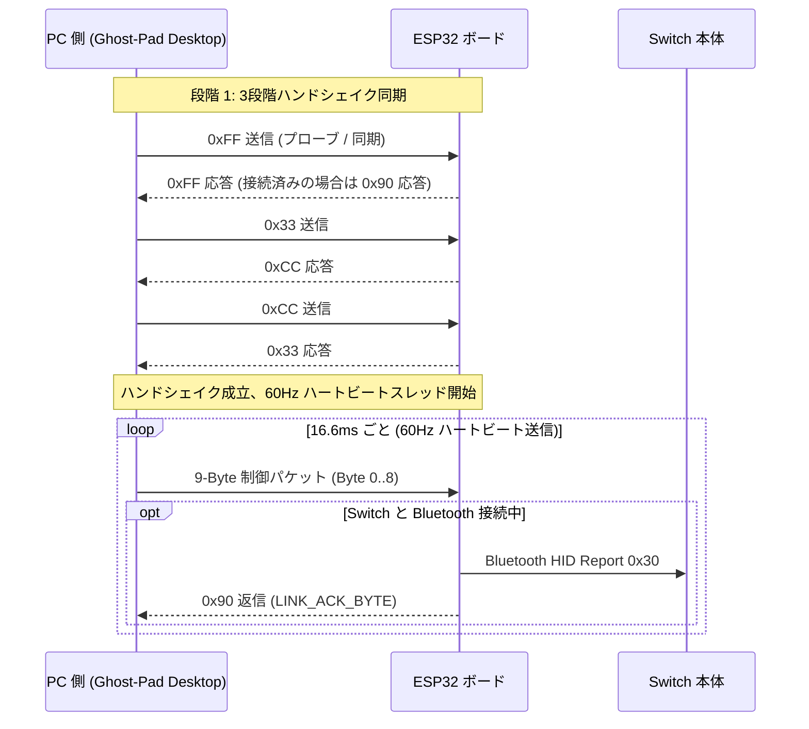

# 🛠️ Ghost-Pad: 技術アーキテクチャおよび通信プロトコル仕様書 (Technical Specification)

<div align="center">

**[English](technical_spec.md) | [繁體中文](technical_spec.zh-TW.md) | [日本語](technical_spec.ja.md)**

</div>

本文書は、**Ghost-Pad (PC-to-Switch Controller Bridge)** の低レイヤシステムアーキテクチャ、シリアル通信プロトコル、ESP32 Bluetooth エミュレーション仕様、ハンドシェイク状態遷移、および Rust バックエンドコアの設計仕様を詳細に記載したものです。

---

## 1. システム全体構成とハードウェアリンク (System Architecture)

```text
  ┌─────────────────────────────────────────────────────────────────────────┐
  │ PC デスクトップ側 (Ghost-Pad Desktop: Tauri v2 + Rust Core + React 19)  │
  │  - コントローラー監視 (gilrs による 8BitDo / Joy-Con / Pro 高速受信)   │
  │  - キーボード・タッチマッピング (WASD スティック計算、Pointer Capture)  │
  │  - 3系統並行入力マージ (Digital OR, Analog Override, Mute 安全機能)    │
  │  - 60Hz 定周期ハートビート送信スレッド & HeldPort 誤リセット防止機能    │
  │  - マクロスタジオ (3-2-1 差分録画、楽譜エディター、ループ再生エンジン)  │
  │  - 109 項目の単元テスト網羅 (フロントエンド Vitest 89件 + バックエンド 20件)│
  └────────────────────────────────────┬────────────────────────────────────┘
                                       │ USB シリアルポート (ボーレート: 19200)
                                       │ バイナリパケットストリーム (UARTSwitchCon 9-Byte)
                                       ▼
  ┌─────────────────────────────────────────────────────────────────────────┐
  │ ESP32 開発ボード (Bluetooth Classic BR/EDR HID)                         │
  │  - 高速シリアル受信割り込みと CRC-8 チェックサム検証 (多項式 0x07)      │
  │  - 200ms ハートビートタイムアウト・フェイルセーフウォッチドッグ         │
  │  - 純正 Pro コントローラーのエミュレーション (VID: 0x057E, PID: 0x2009) │
  │  - L+R ペアリング送信、A/Home 復帰再接続、ペアリング消去 (Clear Bonds)  │
  └────────────────────────────────────┬────────────────────────────────────┘
                                       │ 無線 Bluetooth HID (Report ID 0x30, 48 バイト)
                                       ▼
  ┌─────────────────────────────────────────────────────────────────────────┐
  │ Nintendo Switch 本体                                                    │
  │  - 「持ちかた / 順番をかえる」画面で標準 1P 無線コントローラーとして認識 │
  └─────────────────────────────────────────────────────────────────────────┘
```

---

## 2. 通信プロトコル仕様 (Protocol Specification)

Ghost-Pad は 2 種類のバイナリシリアルプロトコルをサポートしており、標準では **UARTSwitchCon 9-Byte** プロトコルを採用しています。

### 2.1 UARTSwitchCon 9-Byte シリアル通信プロトコル (標準仕様)

通信ボーレートは **19200 bps**、8 データビット、パリティなし、1 ストップビット (8N1) に設定されています。各制御パケットの長さは固定 9 バイトです：

| バイト (Offset) | フィールド名 | 型 / 範囲 | 詳細仕様と定義 |
| :---: | :--- | :---: | :--- |
| **Byte 0** | `btn_hi` (システムボタンマスク) | `u8` (Bitmask) | • Bit 0: Minus (-)<br>• Bit 1: Plus (+)<br>• Bit 2: L Stick Click (L3)<br>• Bit 3: R Stick Click (R3)<br>• Bit 4: Home (⌂)<br>• Bit 5: Capture (◉)<br>• Bit 6~7: 予約 (`0`) |
| **Byte 1** | `btn_lo` (アクションボタンマスク) | `u8` (Bitmask) | • Bit 0: Y<br>• Bit 1: B<br>• Bit 2: A<br>• Bit 3: X<br>• Bit 4: L<br>• Bit 5: R<br>• Bit 6: ZL<br>• Bit 7: ZR |
| **Byte 2** | `dpad` (十字キー方向コード) | `u8` (0~8) | `0`=上, `1`=右上, `2`=右, `3`=右下,<br>`4`=下, `5`=左下, `6`=左, `7`=左上,<br>`8`=ニュートラル中央 (Center) |
| **Byte 3** | `left_stick_x` (左スティック X) | `u8` (0~255) | `0`=左端, `128`=中央, `255`=右端 |
| **Byte 4** | `left_stick_y` (左スティック Y) | `u8` (0~255) | 反転計算後：`255 - app_y`<br>`0`=上端, `128`=中央, `255`=下端 |
| **Byte 5** | `right_stick_x` (右スティック X) | `u8` (0~255) | `0`=左端, `128`=中央, `255`=右端 |
| **Byte 6** | `right_stick_y` (右スティック Y) | `u8` (0~255) | 反転計算後：`255 - app_y`<br>`0`=上端, `128`=中央, `255`=下端 |
| **Byte 7** | `reserved` (予約バイト) | `u8` | 固定値 `0x00` |
| **Byte 8** | `crc8` (チェックサム) | `u8` | Byte 0 〜 7 に対する **CRC-8** (多項式 `0x07`、初期値 `0x00`) |

#### CRC-8 計算アルゴリズムの実装 (Rust)

```rust
pub fn calculate_crc8(data: &[u8]) -> u8 {
    let mut crc: u8 = 0x00;
    for &byte in data {
        crc ^= byte;
        for _ in 0..8 {
            if (crc & 0x80) != 0 {
                crc = (crc << 1) ^ 0x07;
            } else {
                crc <<= 1;
            }
        }
    }
    crc
}
```

---

### 2.2 シリアルハンドシェイク状態遷移 (Handshake State Machine)

ESP32 ファームウェアと PC デスクトップアプリの同期と接続状態を保証するため、厳格な 3 段階ハンドシェイクを実行します：



- **ACK とタイムアウト管理**：
  - ESP32 が Switch とリンク中、正常な 9 バイトパケットを受信すると必ず `0x90` (`LINK_ACK_BYTE`) を返信します。
  - PC 側で 1500ms 以上 `0x90` が届かない場合、Switch 側が切断中またはスリープ中であると判断します。
  - ペアリングモード待機中、ESP32 は 3 秒ごとに L+R パケット（250ms 幅）を自動送信し、Switch 画面上でのペアリングを促します。

---

### 2.3 Custom 10-Byte XOR パケットプロトコル (互換プロトコル)

カスタム Arduino スケッチ等との互換性のため、10-Byte XOR パケットエンコーダーも搭載しています：

| Offset | フィールド | 説明 |
| :---: | :--- | :--- |
| `0` | Header 0 | 固定ヘッダー `0xAA` |
| `1` | Header 1 | 固定ヘッダー `0x55` |
| `2` | `btn_lo` | アクションボタンビットマスク (`Y, B, A, X, L, R, ZL, ZR`) |
| `3` | `btn_hi` | システムボタンビットマスク (`Minus, Plus, L3, R3, Home, Capture`) |
| `4` | `dpad` | 十字キー方向コード (`0~8`) |
| `5` | `left_stick_x` | 左スティック X (`0~255`) |
| `6` | `left_stick_y` | 左スティック Y (`0~255`) |
| `7` | `right_stick_x` | 右スティック X (`0~255`) |
| `8` | `right_stick_y` | 右スティック Y (`0~255`) |
| `9` | `checksum` | XOR チェックサム：`btn_lo ^ btn_hi ^ dpad ^ lx ^ ly ^ rx ^ ry` |

---

## 3. ESP32 Bluetooth Classic エミュレーションとファームウェア仕様

### 3.1 Bluetooth Classic (BR/EDR) HID プロファイル仕様

Nintendo Switch はコントローラーとして **Bluetooth Classic HID (Human Interface Device)** を要求し、BLE には非対応です：
- **ベンダー ID (VID)**：`0x057E` (Nintendo Co., Ltd.)
- **プロダクト ID (PID)**：`0x2009` (Switch Pro Controller)
- **L2CAP チャンネル**：PSM `0x11` (HID Control), PSM `0x13` (HID Interrupt)
- **入力レポート仕様 (Input Report 0x30)**：
  - 48 バイトの標準レポート。3 バイトのボタンフラグ、左右各軸 12 ビット精度のスティック値、および 6 軸ジャイロ・加速度センサー（IMU）データを格納。

### 3.2 結合済みファームウェアバイナリ (`firmware/PRO-UART0.bin`)

リポジトリ内に結合済みファームウェア [`firmware/PRO-UART0.bin`](../firmware/PRO-UART0.bin) を同梱しています：
- ESP-IDF ブートローダー、パーティションテーブル、NVS 領域、UARTSwitchCon アプリケーションをすべて内蔵。
- 開始書き込みアドレスは `0x00000000`。
- Ghost-Pad デスクトップアプリの「ワンクリック書き込み」から直接実行可能。ターミナルから書き込む場合は以下を実行：
  ```bash
  python -m esptool --port <YOUR_PORT> --baud 460800 write-flash 0x0 firmware/PRO-UART0.bin
  ```

---

## 4. Rust バックエンドコアアーキテクチャ (`desktop/src-tauri`)

Rust バックエンドは以下のモジュールで構成されています：

1. **`gamepad.rs` (入力リスナー & マージエンジン)**：
   - `gilrs` クレートを独立したワーカースレッドで実行し、物理コントローラーを監視。
   - 2系統入力マージ（`GamepadManager::merge`）：デジタルボタンは論理和（OR）、スティックと十字キーは仮想入力を優先。
   - スティックのデッドゾーン補正と正規化（`axis_to_u8`）によりドリフトを抑制。
2. **`serial.rs` (シリアル通信とハートビート)**：
   - 19200 ボーレートのシリアル通信を管理し、厳密な 60Hz (16.6ms) ハートビート送信ループを維持。
   - `HeldPort` 管理：macOS においてポートを開閉するたびに DTR/RTS がアサートされて ESP32 が誤リセットされるのを防止するため、検証済みポートを掴んだまま再利用。
   - 特殊コマンド制御：`PairLR`（ペアリングパルス）、`WakeReconnect`（A/Home 復帰パルス）、`ClearBonds`（メモリ消去）、`EmergencyNeutral`（安全中立）。
3. **`protocol.rs` (パケットシリアライズと検証)**：
   - `ControllerState` 構造体および 9 バイト CRC8 / 10 バイト XOR の変換ロジック。
   - CRC-8 アルゴリズムの単体テストを完備。
4. **`lib.rs` (Tauri IPC ブリッジとダイアログ)**：
   - フロントエンド向けの IPC コマンド（`send_virtual_button`, `send_virtual_stick`, `toggle_serial`, `flash_firmware`, `save_file_dialog` など）を公開。

---

## 5. 安全機能とフェイルセーフ (Fail-Safe Mechanisms)

1. **ESP32 ボード側ウォッチドッグ (200ms Timeout)**：
   - 200ms 以上 PC から正常なパケットを受信しなかった場合、自動的に全ボタンを解放し両スティックを中央 (`128, 128`) に復帰させ、暴走を防止。
2. **安全切断プロトコル (Safe Disconnect)**：
   - ポート切断やアプリ終了時、バックエンドが自発的に中立パケットを連続送信し、Switch 側の状態を完全にリセット。
3. **マクロ緊急停止 (`Esc` キー)**：
   - マクロ再生中に `Esc` キーを押すか UI の「緊急停止」をクリックすると、すべての待機タイマーを即座に破棄し、`reset_virtual_inputs` を送信してキー固定を防止。

