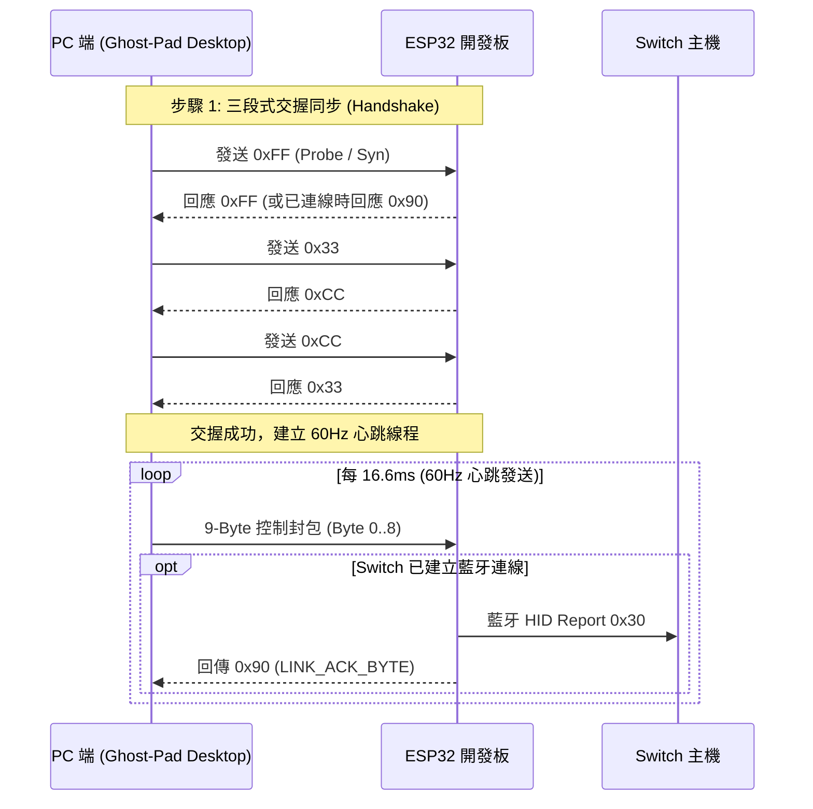

# 🛠️ Ghost-Pad: 技術架構與通訊協定規格書 (Technical Specification)

<div align="center">

**[English](technical_spec.md) | [繁體中文](technical_spec.zh-TW.md) | [日本語](technical_spec.ja.md)**

</div>

本文件詳細記載 **Ghost-Pad (PC-to-Switch Controller Bridge)** 的系統底層架構、序列通訊協定、ESP32 藍牙韌體實作原理、握手狀態機與後端 Rust 核心設計規格。

---

## 1. 系統全景與硬體鏈路 (System Architecture)

```text
  ┌─────────────────────────────────────────────────────────────────────────┐
  │ PC 桌面端 (Ghost-Pad Desktop: Tauri v2 + Rust Core + React 19)          │
  │  - 手把輪詢引擎 (gilrs 原生低延遲監聽 8BitDo / Joy-Con / Switch Pro)     │
  │  - 鍵盤與觸控螢幕映射 (WASD 類比搖桿向量計算、Pointer Capture 120Hz)    │
  │  - 三路輸入動態合併 (Digital OR, Analog Override, Mute Fail-Safe)       │
  │  - 60Hz 心跳定時發送執行緒 & HeldPort 防止 DTR 誤重置保護機制           │
  │  - 巨集工作坊 (3-2-1 差分時序錄製、五線譜時間軸編輯器、循環回放引擎)    │
  │  - 109 項單元測試全覆蓋 (89 前端 Vitest + 20 後端 Rust)                 │
  └────────────────────────────────────┬────────────────────────────────────┘
                                       │ USB 序列埠 (Baudrate: 19200)
                                       │ 二進位封包串流 (UARTSwitchCon 9-Byte)
                                       ▼
  ┌─────────────────────────────────────────────────────────────────────────┐
  │ ESP32 開發板 (Bluetooth Classic BR/EDR HID)                             │
  │  - 高速 Serial 接收中斷與 CRC-8 校驗和驗證 (多項式 0x07)                │
  │  - 200ms 心跳逾時防暴走看門狗 (Heartbeat Watchdog Fail-Safe)           │
  │  - 模擬原廠 Pro Controller (VID: 0x057E, PID: 0x2009)                   │
  │  - 支援 L+R 廣播配對、A/Home 鍵喚醒回連與配對綁定清除 (Clear Bonds)     │
  └────────────────────────────────────┬────────────────────────────────────┘
                                       │ 無線藍牙 HID (Report ID 0x30, 48 Bytes)
                                       ▼
  ┌─────────────────────────────────────────────────────────────────────────┐
  │ Nintendo Switch 主機                                                    │
  │  - 於「更改拿法 / 順序」辨識為標準 1P 無線 Pro Controller                │
  └─────────────────────────────────────────────────────────────────────────┘
```

---

## 2. 通訊協定規範 (Protocol Specification)

Ghost-Pad 支援兩種二進位序列通訊協定，預設標準採用 **UARTSwitchCon 9-Byte** 協定。

### 2.1 UARTSwitchCon 9-Byte 串列通訊協定 (標準協定)

通訊鮑率設定為 **19200 bps**，8 個資料位元、無同位檢查、1 個停止位元 (8N1)。每個控制封包長度固定為 9 個位元組：

| 位元組 (Offset) | 欄位名稱 | 型別 / 範圍 | 詳細規格與定義 |
| :---: | :--- | :---: | :--- |
| **Byte 0** | `btn_hi` (系統功能鍵遮罩) | `u8` (Bitmask) | • Bit 0: Minus (-)<br>• Bit 1: Plus (+)<br>• Bit 2: L Stick Click (L3)<br>• Bit 3: R Stick Click (R3)<br>• Bit 4: Home (⌂)<br>• Bit 5: Capture (◉)<br>• Bit 6~7: 保留 (`0`) |
| **Byte 1** | `btn_lo` (動作按鍵遮罩) | `u8` (Bitmask) | • Bit 0: Y<br>• Bit 1: B<br>• Bit 2: A<br>• Bit 3: X<br>• Bit 4: L<br>• Bit 5: R<br>• Bit 6: ZL<br>• Bit 7: ZR |
| **Byte 2** | `dpad` (十字鍵方向碼) | `u8` (0~8) | `0`=上, `1`=右上, `2`=右, `3`=右下,<br>`4`=下, `5`=左下, `6`=左, `7`=左上,<br>`8`=置中中立 (Center) |
| **Byte 3** | `left_stick_x` (左搖桿 X) | `u8` (0~255) | `0`=極左, `128`=中心點, `255`=極右 |
| **Byte 4** | `left_stick_y` (左搖桿 Y) | `u8` (0~255) | 經反轉計算：`255 - app_y`<br>`0`=極頂, `128`=中心點, `255`=極底 |
| **Byte 5** | `right_stick_x` (右搖桿 X) | `u8` (0~255) | `0`=極左, `128`=中心點, `255`=極右 |
| **Byte 6** | `right_stick_y` (右搖桿 Y) | `u8` (0~255) | 經反轉計算：`255 - app_y`<br>`0`=極頂, `128`=中心點, `255`=極底 |
| **Byte 7** | `reserved` (保留位元組) | `u8` | 固定填入 `0x00` |
| **Byte 8** | `crc8` (校驗碼) | `u8` | 對 Byte 0 ~ 7 進行 **CRC-8** 校驗 (多項式 `0x07`，初始值 `0x00`) |

#### CRC-8 計算演算法實作 (Rust)

```rust
pub fn calculate_crc8(data: &[u8]) -> u8 {
    let mut crc: u8 = 0x00;
    for &byte in data {
        crc ^= byte;
        for _ in 0..8 {
            if (crc & 0x80) != 0 {
                crc = (crc << 1) ^ 0x07;
            } else {
                crc <<= 1;
            }
        }
    }
    crc
}
```

---

### 2.2 序列埠交握與連線狀態機 (Handshake State Machine)

為確保 ESP32 韌體與 PC 桌面端同步並確認連線品質，連線時遵循嚴格的三段式交握程序：



- **ACK 與超時管理**：
  - 當 ESP32 與 Switch 處於連線狀態時，每次成功接收到合法 9-Byte 封包均會回傳 `0x90` (`LINK_ACK_BYTE`)。
  - PC 端若超過 1500ms 未收到 `0x90`，判定 Switch 處於斷線或休眠狀態。
  - 於配對模式中，ESP32 自動以每 3 秒脈衝一次 L+R 封包（長度 250ms），促使 Switch「更改拿法/順序」迅速配對。

---

### 2.3 Custom 10-Byte XOR 封包協定 (備用相容協定)

針對特定自訂 Arduino 韌體架構，Ghost-Pad 後端亦原生實作了 10-Byte XOR 封包編碼器：

| Offset | 欄位 | 說明 |
| :---: | :--- | :--- |
| `0` | Header 0 | 固定標頭碼 `0xAA` |
| `1` | Header 1 | 固定標頭碼 `0x55` |
| `2` | `btn_lo` | 動作按鍵遮罩 (`Y, B, A, X, L, R, ZL, ZR`) |
| `3` | `btn_hi` | 系統按鍵遮罩 (`Minus, Plus, L3, R3, Home, Capture`) |
| `4` | `dpad` | 十字鍵方向碼 (`0~8`) |
| `5` | `left_stick_x` | 左搖桿 X (`0~255`) |
| `6` | `left_stick_y` | 左搖桿 Y (`0~255`) |
| `7` | `right_stick_x` | 右搖桿 X (`0~255`) |
| `8` | `right_stick_y` | 右搖桿 Y (`0~255`) |
| `9` | `checksum` | 逐位異或檢查碼：`btn_lo ^ btn_hi ^ dpad ^ lx ^ ly ^ rx ^ ry` |

---

## 3. ESP32 藍牙模擬與韌體架構

### 3.1 藍牙 Classic (BR/EDR) HID 規範

Nintendo Switch 僅接受 **Bluetooth Classic HID (Human Interface Device)** 手把連線，不支援 BLE：
- **廠商識別碼 (VID)**：`0x057E` (Nintendo Co., Ltd.)
- **產品識別碼 (PID)**：`0x2009` (Switch Pro Controller)
- **L2CAP 通道**：PSM `0x11` (HID Control), PSM `0x13` (HID Interrupt)
- **輸入報告格式 (Input Report 0x30)**：
  - 48 位元組標準報告，每封包包含：3 位元組按鈕狀態、12 位元左右搖桿各軸向精確 ADC 映射、以及 6 軸陀螺儀與加速度計（IMU）空間數據。

### 3.2 預編譯整合韌體 (`firmware/PRO-UART0.bin`)

專案提供單一整合二進位檔 [`firmware/PRO-UART0.bin`](../firmware/PRO-UART0.bin)：
- 包含 ESP-IDF Bootloader、Partition Table、NVS 分區以及 UARTSwitchCon 核心應用程式。
- 起始寫入位址為 `0x00000000`。
- 可透過 Ghost-Pad 桌面應用程式「一鍵燒錄」完成，亦可透過終端機執行：
  ```bash
  python -m esptool --port <YOUR_PORT> --baud 460800 write-flash 0x0 firmware/PRO-UART0.bin
  ```

---

## 4. Rust 後端核心架構 (`desktop/src-tauri`)

後端架構由以下核心模組組成：

1. **`gamepad.rs` (輸入監聽與合併引擎)**：
   - 整合 `gilrs` 庫，在獨立非同步線程中輪詢實體手把事件。
   - 實作雙路輸入合併（`GamepadManager::merge`）：數位按鍵採邏輯聯集（OR）、類比搖桿與十字鍵脫離中立時虛擬輸入具備優先權。
   - 類比軸死區過濾與正規化（`axis_to_u8`），防止微小漂移。
2. **`serial.rs` (序列埠與心跳線程)**：
   - 管理 19200 鮑率序列通訊，維持精確 60Hz (16.6ms) 心跳發送循環。
   - 實作 `HeldPort` 機制：在連線切換期間保持序列埠佔用，防止 macOS 開啟/關閉序列埠觸發 DTR/RTS 導致 ESP32 重置。
   - 特殊指令處理：`PairLR`（L+R 配對訊號）、`WakeReconnect`（A/Home 鍵喚醒）、`ClearBonds`（清除記憶）、`EmergencyNeutral`（安全中立）。
3. **`protocol.rs` (封包編碼與驗證)**：
   - 實作 `ControllerState` 資料結構與 UARTSwitchCon 9-Byte / 10-Byte XOR 封包序列化。
   - 提供標準 CRC-8 演算法與完整單元測試。
4. **`lib.rs` (Tauri IPC 橋接與對話框)**：
   - 提供前端 `send_virtual_button`, `send_virtual_stick`, `toggle_serial`, `flash_firmware`, `save_file_dialog` 等命令呼叫介面。

---

## 5. 安全與防暴走看門狗 (Fail-Safe Mechanisms)

1. **ESP32 板載看門狗 (200ms Timeout)**：
   - ESP32 內部計時器若超過 200ms 未收到來自 PC 的合法序列封包，會自動將所有按鈕釋放、類比搖桿歸位至中心 (`128, 128`)，防止遊戲角色失控暴走。
2. **安全斷線協定 (Safe Disconnect)**：
   - 斷開序列埠或關閉應用程式前，後端主動連續發送多個全中立封包，確認板載狀態完全復位。
3. **巨集緊急中止 (Esc Emergency Abort)**：
   - 巨集回放期間，按下鍵盤 `Esc` 或點擊 UI 緊急按鈕，前端立即銷毀所有定時器並向後端調用 `reset_virtual_inputs`，杜絕按鍵卡死。

